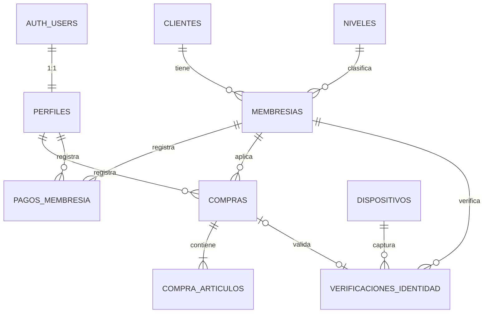

# 00 · Auditoría inicial del proyecto Member+

| Campo | Valor |
|---|---|
| Fecha | 2026-11-09 |
| Rama | `feature/auditoria-proyecto` (creada desde `origin/develop`) |
| Autor | Claude Code (agente), a solicitud de Yerlan Suastegui |
| Fuente de requisitos | *ERS MEMBER+ (actualizado)*, Google Drive, 08/10/2026 (IEEE 830) |
| Estado | **Propuesta. Nada implementado ni creado en Supabase.** |

> Este documento solo analiza y propone. No se crearon tablas, migraciones ni código. Todo lo marcado como **Decisión pendiente** requiere aprobación humana.

---

## 1. Estado general del proyecto

El proyecto está en **etapa cero**: el repositorio existe, pero no hay código, estructura de carpetas ni base de datos de Member+.

| Aspecto | Estado verificado |
|---|---|
| Repositorio | `AGA-Studio/Member-Web`, 1 commit (`1b39ba7 Initial commit`) |
| Ramas | `main` y `origin/develop`, ambas solo con `README.md` (vacío salvo el título) |
| Archivos locales sin seguimiento | `.env`, `.mcp.json`, `main.py` (vacío, 0 bytes) |
| `.gitignore` | **No existe** |
| Código FastAPI | No existe |
| Pruebas / pytest / CI | No existen |
| Herramientas locales | Python 3.14.2, Docker 29.1.3 |
| Conexión a GitHub | No verificable desde el sandbox del agente (sin resolución DNS a github.com) |

**Discrepancia con el documento de arranque:** decía que "existe una estructura inicial de carpetas y archivos en `main`". En `main` y `develop` solo existe `README.md`.

## 2. Arquitectura actual y prevista

**Actual:** ninguna implementada.

**Prevista según el ERS (§2.1 y §3.1.4):** monolito en capas.

```
[Next.js responsivo] --HTTPS--> [FastAPI] ---> [PostgreSQL]
                                    ^
[Lector con cámara (placa Wi-Fi)] --HTTPS (código de tarjeta + imagen)
Despliegue: Docker Compose; producción en Coolify + Cloudflare (HTTPS)
```

**Contradicción a resolver (Decisión pendiente D1):** el ERS describe un PostgreSQL propio levantado con Docker Compose (puerto 5432) y desplegado en Coolify. El equipo decidió usar **Supabase** (PostgreSQL gestionado + Auth + Storage). Se recomienda actualizar el ERS (§2.1, §3.1.3, §3.1.4, RNF Servidor externo) para reflejarlo:
- La BD ya no forma parte del Docker Compose de producción.
- Para desarrollo local se usa `supabase start` (stack local en Docker), no un contenedor Postgres propio.

## 3. Estado de Supabase (verificación de solo lectura)

Verificado con peticiones de solo lectura que leen el `.env` local. No se imprimió ninguna clave.

| Hallazgo | Detalle | Severidad |
|---|---|---|
| **El `.env` apunta a dos proyectos distintos** | `SUPABASE_URL`, `DB_USER`/`DB_HOST` y `SUPABASE_SERVICE_ROLE_KEY` pertenecen a **otro proyecto de Supabase**: el de un sistema Django anterior (≈40 tablas: `auth_user`, `django_migrations`, `servicio`, `oferta`, `postulacion`, `vista_*`…). Solo `NEXT_PUBLIC_SUPABASE_URL` y la publishable key coinciden con el proyecto del MCP (`.mcp.json`), que es el de Member+. | **Crítica** |
| Riesgo de operar sobre la BD equivocada | Cualquier migración o script que use `DB_*` o la service role se ejecutaría contra la BD del otro sistema. | **Crítica** |
| Proyecto Member+ (verificado vía MCP) | Esquema `public` **vacío**: 0 tablas y 0 migraciones registradas. Storage sin buckets. Advisors de seguridad sin avisos. Extensiones instaladas: `pgcrypto`, `uuid-ossp`, `pg_stat_statements`, `supabase_vault`. Disponibles sin instalar y útiles para el proyecto: `citext`, `vector` (embeddings faciales, D4), `pg_cron` (expiraciones), `pgtap` (pruebas de RLS). | OK |
| Registro público habilitado | `disable_signup = false` en el proyecto Member+. El ERS dice que solo admin y empleados acceden, así que el auto-registro debe desactivarse. | Alta |
| MCP de Supabase | Funciona con el proyecto Member+ (el mismo de `.mcp.json`). Expone herramientas de escritura (`apply_migration`, `execute_sql`): los agentes solo deben usarlas tras aprobar la migración en un PR. | Media |
| Variables `NEXT_PUBLIC_*` en el `.env` del backend | Es aceptable que existan, pero el frontend debe tener su propio `.env` y nunca recibir `SUPABASE_SERVICE_ROLE_KEY`. | Media |

**Acción requerida por un humano (no la puede hacer el agente):** reemplazar en `.env` los valores de `SUPABASE_URL`, `SUPABASE_ANON_KEY`, `SUPABASE_SERVICE_ROLE_KEY`, `SUPABASE_JWKS_URL` y `DB_*` por los del proyecto Member+. Además:
- Considerar **rotar** la service role key del proyecto anterior, porque quedó copiada en otro repositorio local.
- Crear `.gitignore` **antes** de cualquier `git add`.

## 4. Requisitos identificados (ERS)

### Funcionales

| ID ERS (tabla) | §3.2 | Requisito | Entidades implicadas |
|---|---|---|---|
| RF01 | RF1 | Creación / CRUD de tarjetas de membresía | membresía, cliente, nivel |
| RF02 | RF1 | Cancelación de membresía (anulada o expirada) + récord de pagos | membresía, pago |
| RF03 | RF2 | Renovación: nueva fecha de expiración + récord de pagos | membresía, pago |
| RF04 | RF3 | Historial de compras (precio, id de artículo, fecha) | compra, detalle |
| RF05 | RF4 | Mostrar puntos acumulados (también en el comprobante) | compra, saldo |
| RF06 | RF5 | Niveles de tarjeta (Básico/Plata/Oro) con % de puntos, cashback y descuento | nivel |
| RF07 | RF6 | Registro y administración de clientes + foto para verificación | cliente, Storage |
| — | RF7 | Inicio de sesión con roles (admin, empleado) | perfil, auth.users |
| — | RF8 | Registro de compras con cálculo automático de descuento, puntos y cashback | compra |
| — | RF9 | Lectura de tarjeta por el lector, que envía el dato a la API | dispositivo, membresía |
| — | RF10 | Verificación facial antes de aplicar beneficios; confirmación manual si falla | verificación |
| — | RF11 | Consulta de movimientos por tarjeta (altas, renovaciones, cancelaciones, compras) | vista de movimientos |

### No funcionales relevantes para backend y BD
- **Seguridad:** contraseñas protegidas, permisos por rol, HTTPS, datos biométricos solo para verificación, guardar lo mínimo y no compartir con terceros.
- **Fiabilidad:** modo manual si el lector falla.
- **Disponibilidad:** lectura y verificación en pocos segundos.
- **Mantenimiento:** respaldos periódicos y cambios documentados.
- **Portabilidad:** Docker.

### Problemas del ERS (informar antes de implementar)
1. La numeración no coincide: la tabla de requisitos tiene RF01–RF07, pero §3.2 tiene RF1–RF11, con "Requisito funcional 1" duplicado. RF7–RF11 no tienen ficha.
2. Ningún requisito tiene marcada la **prioridad** ni el tipo (casillas vacías).
3. RF1 dice "CRUD de tarjetas" pero describe "datos de sus clientes": mezcla dos entidades.
4. En los casos de uso el actor "cliente" opera el sistema, pero §2.3 indica que el cliente no tiene acceso.
5. No se define cómo se **usan** los puntos ni el cashback (¿canje? ¿saldo a favor?). Solo se acumulan.
6. No se definen el precio ni la duración de cada nivel o membresía, aunque el ERS menciona un "récord de pagos".
7. "Seleccionar artículos" (caso de uso Realizar compra) choca con "fuera de alcance: inventario/POS". No está claro de dónde salen los artículos.
8. Los diagramas (arquitectura, componentes, despliegue, actividades) son imágenes y no se pudieron leer como texto. Hay que revisarlos manualmente.

## 5. Funcionalidades existentes y pendientes

| Funcionalidad | Estado |
|---|---|
| Todas (RF1–RF11) | **Pendientes.** No hay implementación. |
| Infraestructura (estructura FastAPI, config, CI, Docker) | Pendiente |
| Base de datos Member+ | Pendiente (sin verificar si el proyecto está vacío) |

## 6. Propuesta de modelo entidad-relación

Cada entidad se justifica con un requisito. Lo que el ERS no define se marca como decisión pendiente en vez de inventarse.



### 6.1 Tablas propuestas (esquema `public`)

**`perfiles`** (RF7). Perfil de los usuarios del sistema, ligado a `auth.users`.
| Campo | Tipo | Reglas |
|---|---|---|
| id | uuid PK | FK → `auth.users(id)` ON DELETE CASCADE |
| nombre | text | NOT NULL |
| rol | `rol_usuario` enum(`admin`,`empleado`) | NOT NULL, default `empleado` |
| activo | boolean | NOT NULL default true |
| created_at / updated_at | timestamptz | default now(); trigger de actualización |

Las contraseñas las gestiona Supabase Auth (bcrypt), nunca la tabla. El rol se guarda en la tabla, no en `user_metadata`, porque `user_metadata` lo puede editar el propio usuario.

**`clientes`** (RF6/RF07).
| Campo | Tipo | Reglas |
|---|---|---|
| id | uuid PK | default `gen_random_uuid()` |
| nombre, apellidos | text | NOT NULL, `char_length > 0` |
| email | citext | UNIQUE, nullable |
| telefono | text | nullable, CHECK de formato |
| foto_path | text | ruta en bucket **privado** `rostros` |
| rostro_embedding | bytea / vector | **Decisión pendiente D4** |
| consentimiento_biometrico_at | timestamptz | requerido antes de guardar la foto (datos sensibles) |
| activo | boolean | borrado lógico; ver nota |
| created_at / updated_at | timestamptz | |

El ERS dice "eliminar clientes". Se propone **borrado lógico** para no romper el historial de compras (integridad referencial), y borrar la foto y el embedding al desactivar. Está sujeto a aprobación.

**`niveles`** (RF5/RF06).
| Campo | Tipo | Reglas |
|---|---|---|
| id | smallint identity PK | |
| nombre | text | UNIQUE NOT NULL |
| orden | smallint | UNIQUE; un número mayor es un nivel más alto |
| pct_descuento, pct_puntos, pct_cashback | numeric(5,2) | CHECK 0–100 |
| precio | numeric(10,2) | **D5**: el ERS no lo define |
| duracion_meses | smallint | **D5** |
| activo | boolean | |

**`membresias`** (RF1–RF3, RF9). Equivalen a la "tarjeta".
| Campo | Tipo | Reglas |
|---|---|---|
| id | uuid PK | |
| cliente_id | uuid FK → clientes | NOT NULL, ON DELETE RESTRICT |
| nivel_id | smallint FK → niveles | NOT NULL |
| codigo_tarjeta | text | UNIQUE NOT NULL; es lo que envía el lector |
| estado | enum(`activa`,`cancelada`,`expirada`) | NOT NULL |
| fecha_inicio, fecha_expiracion | date | CHECK `fecha_expiracion > fecha_inicio` |
| cancelada_at, motivo_cancelacion | timestamptz, text | obligatorios si `estado='cancelada'` (CHECK) |
| created_at / updated_at | timestamptz | |

Índice único parcial: **una sola membresía activa por cliente**, `UNIQUE (cliente_id) WHERE estado='activa'`.

**`pagos_membresia`** (récord de pagos, RF1–RF3).
| Campo | Tipo | Reglas |
|---|---|---|
| id | uuid PK | |
| membresia_id | uuid FK | NOT NULL |
| tipo | enum(`alta`,`renovacion`) | |
| monto | numeric(10,2) | CHECK ≥ 0 |
| periodo_inicio, periodo_fin | date | |
| registrado_por | uuid FK → perfiles | |
| created_at | timestamptz | inmutable (sin UPDATE/DELETE) |

**`compras`** (RF3, RF4, RF8).
| Campo | Tipo | Reglas |
|---|---|---|
| id | uuid PK | |
| membresia_id | uuid FK | NOT NULL |
| registrado_por | uuid FK → perfiles | NOT NULL |
| subtotal, descuento_monto, total | numeric(10,2) | CHECK ≥ 0, `total = subtotal - descuento_monto` |
| pct_descuento_aplicado, pct_puntos_aplicado, pct_cashback_aplicado | numeric(5,2) | **copia de los porcentajes del nivel en ese momento**, para que el historial no cambie si se edita el nivel |
| puntos_ganados | integer | CHECK ≥ 0 |
| cashback_ganado | numeric(10,2) | CHECK ≥ 0 |
| metodo_verificacion | enum(`facial`,`manual`) | NOT NULL (RF10) |
| created_at | timestamptz | índice `(membresia_id, created_at desc)` |

**`compra_articulos`** (RF3: "precio, id de artículo y fecha").
| Campo | Tipo | Reglas |
|---|---|---|
| id | bigint identity PK | |
| compra_id | uuid FK ON DELETE CASCADE | |
| articulo_codigo | text | NOT NULL; texto libre porque no hay inventario (**D6**) |
| descripcion | text | |
| cantidad | integer | CHECK > 0 |
| precio_unitario | numeric(10,2) | CHECK ≥ 0 |

**`verificaciones_identidad`** (RF10, NFR seguridad).
| Campo | Tipo | Reglas |
|---|---|---|
| id | uuid PK | |
| membresia_id | uuid FK | |
| dispositivo_id | uuid FK → dispositivos | nullable (manual) |
| compra_id | uuid FK | nullable |
| resultado | enum(`aprobada`,`rechazada`,`manual`) | |
| puntaje | numeric(5,4) | nullable |
| confirmado_por | uuid FK → perfiles | obligatorio si `resultado='manual'` |
| created_at | timestamptz | |

**No se guarda la imagen capturada en caja.** El ERS pide guardar solo lo necesario.

**`dispositivos`** (RF9). Los lectores necesitan autenticarse contra la API. El ERS exige inicio de sesión para acceder a la API, y una placa IoT no puede iniciar sesión como un usuario.
| Campo | Tipo | Reglas |
|---|---|---|
| id | uuid PK | |
| nombre | text | UNIQUE |
| token_hash | text | hash del token del dispositivo; nunca en texto plano |
| activo | boolean | |
| ultimo_contacto_at | timestamptz | |

### 6.2 Vistas (evitan duplicar datos)
- **`v_movimientos`** (RF11): `UNION` de altas y renovaciones (`pagos_membresia`), cancelaciones (`membresias.cancelada_at`) y compras, con `membresia_id`, `tipo`, `fecha` y `referencia_id`. No se crea una tabla de movimientos para no duplicar información.
- **`v_saldo_membresia`** (RF4): `SUM(puntos_ganados)` y `SUM(cashback_ganado)` por membresía. Si se aprueba el canje de puntos (**D3**), se agrega la tabla `canjes` y se resta aquí.
- Las vistas se crean con `security_invoker = true` para que respeten el RLS de las tablas base.

### 6.3 Reglas de negocio y dónde viven
| Regla | Ubicación propuesta |
|---|---|
| Cálculo de descuento, puntos y cashback | **FastAPI** (servicio `compras`), con pruebas unitarias. La BD solo guarda el resultado y valida los CHECK. |
| Expiración de membresía | Estado derivado: FastAPI considera "expirada" una membresía con `fecha_expiracion < hoy`. Opcionalmente, un job con `pg_cron` actualiza `estado`. |
| Una membresía activa por cliente | BD (índice único parcial) |
| Inmutabilidad de pagos y compras | BD (sin políticas de UPDATE/DELETE) |
| `updated_at` | BD (trigger) |

Para no duplicar lógica, la BD garantiza la **integridad** y FastAPI implementa los **cálculos y flujos**.

## 7. Seguridad y RLS propuestas

**Modelo de acceso recomendado (Decisión pendiente D2):**
- El frontend (Next.js) usa Supabase **solo para Auth** (login). Obtiene el JWT y llama a FastAPI con `Authorization: Bearer <jwt>`.
- FastAPI valida el JWT con **JWKS** (`SUPABASE_JWKS_URL` ya está previsto en el `.env`), carga el `perfil` y aplica permisos por rol.
- FastAPI accede a Postgres con una conexión de servidor, que se salta el RLS. Por eso la autorización real está en FastAPI.
- El **RLS se activa en todas las tablas** como defensa en profundidad: si alguien usa la publishable key directo contra PostgREST, no obtiene nada.

| Tabla | anon | authenticated (empleado) | authenticated (admin) |
|---|---|---|---|
| perfiles | ✗ | SELECT propio | SELECT/INSERT/UPDATE todos |
| clientes | ✗ | SELECT, INSERT, UPDATE | todo |
| niveles | ✗ | SELECT | todo |
| membresias | ✗ | SELECT, INSERT, UPDATE | todo |
| pagos_membresia | ✗ | SELECT, INSERT | SELECT, INSERT |
| compras / compra_articulos | ✗ | SELECT, INSERT | SELECT, INSERT |
| verificaciones_identidad | ✗ | SELECT, INSERT | SELECT, INSERT |
| dispositivos | ✗ | ✗ | todo |

- Funciones auxiliares `public.es_admin()` y `public.es_personal()`: `SECURITY DEFINER`, `search_path` fijo, leen `perfiles` con `auth.uid()`.
- Bucket **`rostros` privado**. Solo el backend lo lee o escribe. Nunca hay URLs públicas; si hacen falta, se usan URLs firmadas de corta duración.
- **Desactivar el registro público** en Auth. El admin crea a los empleados desde FastAPI (`auth.admin.create_user`, con la service role, solo en el servidor).
- La service role nunca va al frontend ni a GitHub. Se agrega `.env.example` sin valores y `.gitignore`.
- Los datos biométricos son datos personales sensibles. Se recomienda registrar el consentimiento del cliente (campo `consentimiento_biometrico_at`).

## 8. Integración FastAPI ↔ Supabase

| Aspecto | Recomendación |
|---|---|
| Acceso a datos | **SQLAlchemy 2.x (async) + asyncpg**, con transacciones explícitas (por ejemplo, registrar la compra, sus artículos y la verificación en una sola transacción). |
| Pooler | El `.env` usa el puerto 6543 (*transaction pooler*), que no admite *prepared statements*. Hay dos opciones: usar el *session pooler* (5432) para el backend, o configurar `statement_cache_size=0`. |
| Migraciones | **Supabase CLI** (`supabase/migrations/<timestamp>_*.sql`), no Alembic, para tener una sola fuente de verdad del esquema, que incluye RLS, políticas y Storage. Los modelos SQLAlchemy se mapean al esquema sin crearlo (`create_all` prohibido). |
| Cliente `supabase-py` | Solo para Auth admin (crear empleados) y Storage (fotos). |
| Auth | Dependencia `get_current_user` (validación JWT con JWKS y caché) y `require_role("admin")`. |
| Lector IoT | Endpoint `/lector/...` autenticado con token de dispositivo (hash en `dispositivos`), distinto del JWT de usuarios. |
| Validación | Pydantic v2 en esquemas de entrada y salida; `Decimal` para dinero. |
| Errores | Traducir errores de Postgres (unique, FK, check) a 409/422 con mensajes claros. |
| Configuración | `pydantic-settings` leyendo `.env`. |

**Decisión pendiente D4, verificación facial:** el ERS no define la técnica. Opciones:
- Librería en el backend (`face_recognition`/dlib o DeepFace), que guarda solo el *embedding*.
- Un servicio externo. Choca con el requisito de "no compartir con terceros".

Esto afecta a las dependencias y a la imagen Docker. Lo debe decidir el equipo con el responsable de IoT.

## 9. Estrategia de pruebas recomendada

- **Herramientas:** pytest, httpx + `TestClient`/`AsyncClient`, pytest-cov y Ruff (lint y formato).
- **`tests/unit/`:** cálculo de compra por nivel, reglas de expiración y renovación, validadores Pydantic. Sin BD.
- **`tests/integration/`:**
  - Repositorios contra un **Supabase local** (`supabase start` en Docker).
  - Restricciones: unique, CHECK, FK, una membresía activa.
  - **Pruebas de RLS** con JWT de anon, empleado y admin.
- **`tests/functional/`:** flujos completos por API (alta de cliente → membresía → lectura → verificación → compra → movimientos).
- **Nunca** se ejecutan pruebas contra el proyecto Supabase compartido.
- **CI (GitHub Actions):** Ruff + pruebas unitarias en cada PR. Las de integración, con Supabase CLI en el runner.
- Meta inicial de cobertura: 80 % en `services/`.

## 10. Estructura propuesta del repositorio

```
Member-Web/
├── backend/
│   ├── app/
│   │   ├── main.py                  # COMPARTIDO
│   │   ├── core/                    # COMPARTIDO: config, db, security, errors
│   │   └── modules/
│   │       ├── auth/  usuarios/  clientes/  niveles/
│   │       ├── membresias/  compras/  lector/  movimientos/
│   │       │   └── (router.py, schemas.py, service.py, repository.py, models.py)
│   ├── tests/{unit,integration,functional}/
│   ├── pyproject.toml               # COMPARTIDO (deps, ruff, pytest)
│   └── Dockerfile
├── frontend/                        # Next.js (D7: ¿mismo repo o separado?)
├── supabase/
│   ├── config.toml
│   ├── migrations/
│   └── seed.sql                     # niveles de ejemplo, solo para entorno local
├── docs/
│   ├── 00-auditoria-proyecto.md
│   └── 02-arquitectura/{database-design,entity-relationship,database-security}.md
├── .github/workflows/ci.yml         # COMPARTIDO
├── docker-compose.yml               # COMPARTIDO
├── .env.example  .gitignore         # COMPARTIDO
├── AGENTS.md  CLAUDE.md             # reglas para agentes (no existen aún)
└── README.md
```

La raíz `main.py` (vacía, sin seguimiento) se reemplazaría por `backend/app/main.py`. No se tocará sin autorización.

## 11. Distribución entre dos desarrolladores

Basada en los roles del ERS (§1.3). En el ERS, Yerlan es responsable de "API, BD y reglas (membresías, niveles, puntos, descuentos, permisos)" y Arturo de "construir las APIs". Si los dos desarrolladores son otros, se ajusta.

| Dev A: BD, reglas y QA | Dev B: API y flujos |
|---|---|
| `supabase/migrations`, RLS, Storage | `core/security` (JWT/JWKS), `auth`, `usuarios` |
| `niveles`, `membresias` (alta, renovación, cancelación, pagos) | `clientes` (+ fotos), `lector` (dispositivos) |
| Servicio de cálculo de compra (unit tests) | `compras` (endpoint y transacción), `movimientos` |
| Pruebas de integración y RLS | Pruebas funcionales de API |

Cada módulo es una carpeta propia, lo que reduce conflictos. Los contratos entre módulos (esquemas Pydantic) se acuerdan antes de implementar.

## 12. Organización de agentes

- **Un worktree por tarea:** `git worktree add ../mw-<tarea> -b feature/<tarea> develop`.
- **Claude Code:** implementación de la tarea asignada, en su rama y con su lista de archivos autorizados.
- **DeepSeek:** revisión de PR, generación de casos de prueba y análisis. No hace commits en ramas ajenas.
- **Solo un agente** es dueño de `supabase/migrations` a la vez. Las migraciones se nombran con timestamp (Supabase CLI), para evitar choques de numeración.
- Crear `AGENTS.md` y `CLAUDE.md` con estas reglas: ramas, archivos compartidos, prohibiciones de Git y comandos de prueba.

## 13. Ramas

- `main`: estable, protegida. Solo se integra por PR desde `develop`.
- `develop`: integración, protegida, PR con 1 revisión y CI verde.
- `feature/<id>-<nombre>`, `fix/<id>-<nombre>`, `test/<modulo>`, `docs/<tema>`.
- **Recomendación:** activar *branch protection* en GitHub para `main` y `develop` (lo hace un humano).

## 14. Archivos compartidos que requieren coordinación

`backend/app/main.py` (registro de routers), `backend/app/core/*`, `pyproject.toml`/dependencias, `supabase/migrations/*`, `supabase/seed.sql`, `.env.example`, `.github/workflows/*`, `docker-compose.yml`, `tests/conftest.py`, `AGENTS.md`/`CLAUDE.md`.

Regla: un PR que toque estos archivos se anuncia antes y se revisa por los dos desarrolladores.

## 15. Plan de implementación por etapas

| Etapa | Contenido | Requiere aprobación |
|---|---|---|
| 0 | Humano: corregir el `.env` al proyecto Member+, rotar la key anterior, desactivar el signup público, proteger ramas | — |
| 1 | `.gitignore`, `.env.example`, estructura `backend/`, `pyproject.toml`, Ruff, pytest, CI mínimo, `AGENTS.md`/`CLAUDE.md` | Sí (archivos compartidos) |
| 2 | Migración inicial: enums, `perfiles`, `niveles`, `clientes`, `membresias`, `pagos_membresia`, RLS y funciones de rol. Primero en Supabase local; al proyecto remoto solo tras revisión. | **Sí** |
| 3 | Migración: `compras`, `compra_articulos`, `dispositivos`, `verificaciones_identidad`, vistas, bucket `rostros` | **Sí** |
| 4 | FastAPI core: config, conexión, JWT/JWKS, roles, manejo de errores | Sí |
| 5 | Módulos en paralelo (ver §11) con pruebas | Por PR |
| 6 | Integración del lector y la verificación facial (tras D4) | Sí |
| 7 | Docker, despliegue y documentación `docs/02-arquitectura/*` | Por PR |

## 16. Decisiones pendientes (requieren respuesta humana)

| ID | Pregunta |
|---|---|
| D1 | ¿Se confirma Supabase en lugar del PostgreSQL propio del ERS? ¿Se actualiza el ERS? |
| D2 | ¿El frontend accede a datos solo vía FastAPI (recomendado) o también directo a Supabase? |
| D3 | ¿Los puntos y el cashback se canjean? ¿Cómo? (el ERS no lo define) |
| D4 | Técnica de verificación facial y dónde se ejecuta |
| D5 | ¿Los niveles tienen precio y duración? ¿Puede cambiar de nivel una membresía activa (ascenso)? |
| D6 | ¿Los artículos de una compra se capturan como texto libre o habrá un catálogo mínimo? |
| D7 | ¿El frontend Next.js vive en este repositorio o en otro? |
| D8 | ¿"Eliminar cliente" es borrado lógico (recomendado) o físico? |
