# Arquitectura del backend — Member+

Documentación del backend (este repositorio). Los diagramas están en [Mermaid](https://mermaid.js.org/) y se ven directamente en GitHub y en VS Code (con la extensión *Markdown Preview Mermaid Support*).

> El código está en inglés; esta documentación, en español. Cuando un nombre aparece `así`, es el nombre exacto en el código.

## 1. Vista general

Member+ es un SaaS multi-negocio: un solo despliegue atiende a varios negocios (`Business`). Cada dato de negocio lleva `business_id`, y ese valor **siempre sale del token** del usuario, nunca del cuerpo de la petición.

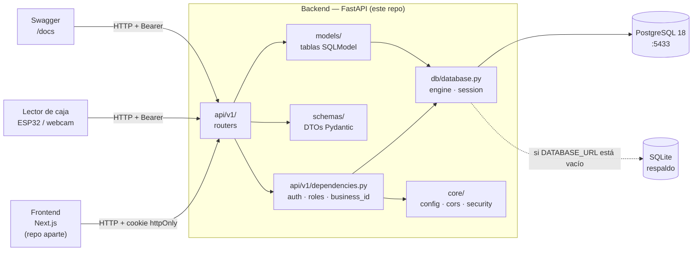

## 2. Estructura de carpetas

```mermaid
flowchart TB
    ROOT["Member-Web/"]
    ROOT --> MAIN["main.py<br/>create_app · lifespan · CORS · routers"]
    ROOT --> CORE["core/"]
    ROOT --> DBF["db/"]
    ROOT --> MOD["models/"]
    ROOT --> SCH["schemas/"]
    ROOT --> API["api/v1/"]
    ROOT --> SRV["services/"]
    ROOT --> SCR["scripts/"]
    ROOT --> MIGR["migrations/"]
    ROOT --> TST["tests/"]
    ROOT --> CFG["pyproject.toml · uv.lock · alembic.ini<br/>docker-compose.yml · .env"]

    CORE --> C1["config.py — Settings (lee .env)"]
    CORE --> C2["cors.py — setup_cors(app)"]
    CORE --> C3["security.py — Argon2id + JWT"]
    CORE --> C4["errors.py — ApiError · ErrorCode (code estable en errores)"]
    DBF --> D1["database.py — engine · check_database_connection · get_session"]
    MIGR --> MG1["env.py — conecta Alembic con settings y models"]
    MIGR --> MG2["versions/ — una migración por cambio"]
    MOD --> M1["business_model.py — Business, BusinessStatus"]
    MOD --> M2["user_model.py — User, Role"]
    MOD --> M3["enum_utils.py — enum_values (enums en minúscula)"]
    MOD --> M4["revoked_token_model.py — RevokedToken"]
    MOD --> M5["login_attempt_model.py — LoginAttempt"]
    MOD --> M6["tier_model.py — Tier, TierFinish"]
    MOD --> M7["customer_model.py — Customer (cliente y su tarjeta)"]
    MOD --> M8["purchase_model.py — Purchase (compra = movimiento = comprobante)"]
    SRV --> SV1["auth_service.py — revocación de tokens · límite de login"]
    SRV --> SV2["tier_service.py — listar y editar niveles · reglas de rango"]
    SRV --> SV3["customer_service.py — clientes · código · estado · saldos · paginación"]
    SRV --> SV4["pricing_service.py — fórmula de caja (pura)"]
    SRV --> SV5["checkout_service.py — cobrar · comprobante · Idempotency-Key"]
    SCR --> SC1["seed.py — 2 negocios demo, usuarios, niveles, clientes y compras"]
    SCH --> S1["user_schema.py — UserCreate · UserUpdate · UserResponse · MeResponse"]
    SCH --> S4["business_schema.py — BusinessSummaryResponse"]
    SCH --> S2["token_schema.py — Token · TokenData"]
    SCH --> S3["validators.py — PersonName"]
    SCH --> S5["tier_schema.py — TierUpdate · TierResponse"]
    SCH --> S6["customer_schema.py — CustomerCreate · CustomerUpdate · CustomerResponse"]
    SCH --> S7["pagination_schema.py — PageResponse"]
    SCH --> S8["checkout_schema.py — CheckoutCreate · ReceiptResponse"]
    API --> A1["dependencies.py — CurrentUser · require_roles · BusinessId<br/>ensure_user_can_access"]
    API --> A2["auth_api.py — /auth"]
    API --> A3["user_api.py — /user"]
    API --> A4["tier_api.py — /tier"]
    API --> A5["customer_api.py — /customer"]
    API --> A6["checkout_api.py — /checkout"]
```

## 3. Modelo de datos actual

Existen las tablas de autenticación, los niveles, los clientes con su tarjeta y las compras; `python -m scripts.seed` las llena con dos negocios de demo (Café Aurora y Gimnasio Titán), sus usuarios, sus niveles, sus clientes (12 y 2) y sus compras (12 y 1).

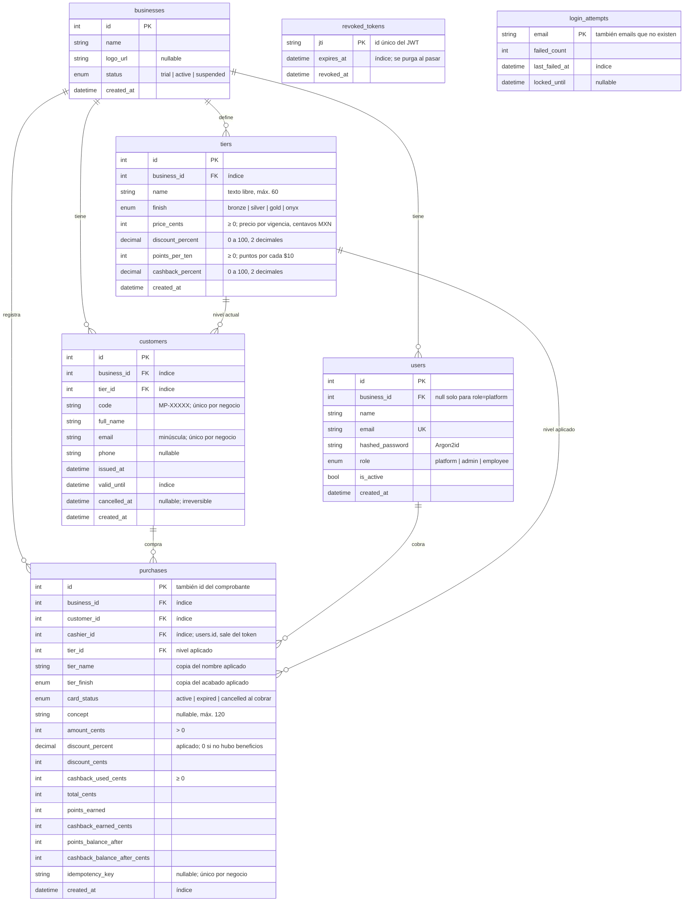

**Niveles (`tiers`).** Cada negocio define los suyos; el seed solo carga una plantilla (Bronce, Plata, Oro y Onyx en Café Aurora; Básico y Premium en Gimnasio Titán). `finish` es el acabado visual de la tarjeta y lo elige el negocio; el nombre es libre. Un beneficio en `0` equivale a deshabilitado para ese nivel. **El cliente sube de nivel pagando** (decisión "por cobro": mejor nivel = más beneficio y más costo), así que cada nivel tiene `price_cents` y no hay umbral de puntos; los puntos solo son un saldo. Los rangos se validan en `services/tier_service.py` (422 `tier_invalid`) y la base los repite con restricciones `CHECK` como última defensa.

`revoked_tokens` (H2) y `login_attempts` (H4) son tablas de seguridad, no datos de un negocio: no llevan `business_id` ni se relacionan con `users`. Se limpian solas: un token revocado se borra cuando ya habría expirado, y un registro de intentos se borra al iniciar sesión bien o cuando pasa la ventana de bloqueo.

### Roles

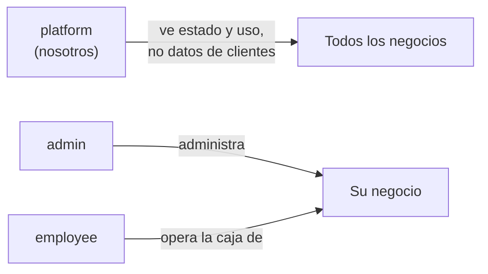

### Estados de un negocio

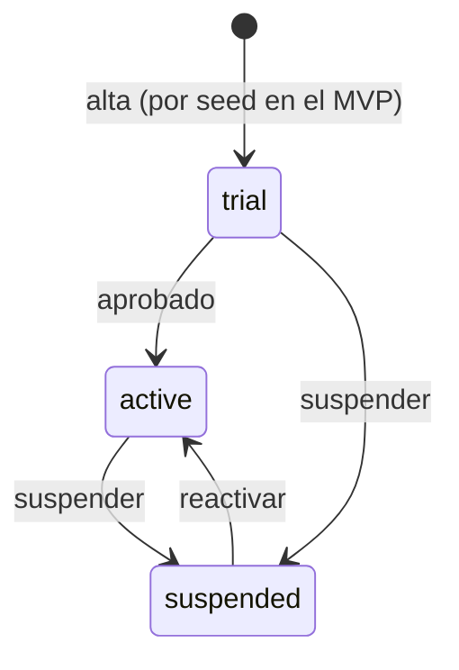

| Estado | ¿Sus usuarios pueden entrar? |
|--------|------------------------------|
| `trial` | Sí |
| `active` | Sí |
| `suspended` | **No**: 403 `Business suspended` en el login y en cualquier petición, aunque ya tengan sesión abierta |

En la base los valores de los `ENUM` se guardan en minúscula (`'admin'`, `'suspended'`), igual que en la API. Ver [MIGRATIONS.md](MIGRATIONS.md#7-migraciones-existentes).

## 4. Endpoints

Prefijo común: `/api/v1`. Documentación interactiva en `http://127.0.0.1:8000/docs`.

| Método | Ruta | Rol requerido | Qué hace |
|--------|------|---------------|----------|
| GET | `/health` | — | Estado de la API |
| POST | `/api/v1/auth/login` | — | Login con email y contraseña; deja cookie y devuelve el token. Tras 5 intentos fallidos por email responde 429 durante 15 min |
| POST | `/api/v1/auth/logout` | — | Revoca el token de esta sesión (cookie o Bearer) y borra la cookie. Las demás sesiones del usuario siguen abiertas |
| GET | `/api/v1/auth/me` | cualquier usuario activo | Usuario de la sesión y su negocio (`business`: `id`, `name`, `logo_url`, `status`; `null` para `platform`) |
| GET | `/api/v1/user/list` | admin | Usuarios de su negocio |
| POST | `/api/v1/user/create` | admin | Crea un admin o employee en su negocio |
| GET | `/api/v1/user/{user_id}` | admin | Detalle de un usuario de su negocio |
| PATCH | `/api/v1/user/{user_id}/update` | admin | Edita nombre, email, contraseña o `is_active`. Un admin no puede desactivarse a sí mismo (400) |
| GET | `/api/v1/tier/list` | admin, employee | Niveles de su negocio, sin paginar, del más barato al más caro (`price_cents`), con `customers_count` |
| PATCH | `/api/v1/tier/{tier_id}/update` | admin | Edita `name`, `finish`, `price_cents`, `discount_percent`, `points_per_ten`, `cashback_percent` (todos opcionales). Fuera de rango → 422 `tier_invalid` |
| GET | `/api/v1/customer/list` | admin | Clientes paginados por `full_name`. Filtros `q` (nombre, email o código), `level_id`, `status` (`active` \| `expiring` \| `expired` \| `cancelled`), `page`, `page_size` (8 por defecto, máx. 500). Una página que no existe devuelve la última |
| GET | `/api/v1/customer/summary` | admin | Conteos `all`, `active` (incluye las por vencer), `expiring`, `expired`, `cancelled` |
| GET | `/api/v1/customer/lookup` | admin, employee | Tarjeta por `code` (QR o tecleado; ignora espacios y mayúsculas). Responde también para vencidas y canceladas. 404 `customer_not_found` |
| POST | `/api/v1/customer/create` | admin | Alta con `full_name`, `email`, `phone` y `level_id` opcionales. Genera `code`, `issued_at` y `valid_until` (+12 meses). 409 `email_taken` |
| GET | `/api/v1/customer/{customer_id}` | admin | Ficha del cliente |
| PATCH | `/api/v1/customer/{customer_id}/update` | admin | Edita `full_name`, `email`, `phone` (`null` lo borra) o `level_id` (cambio de nivel). 409 `email_taken` |
| POST | `/api/v1/customer/{customer_id}/cancel` | admin | Cancela la tarjeta; irreversible y repetirlo no cambia nada |
| POST | `/api/v1/checkout/preview` | admin, employee | Mismo cuerpo que `create`; calcula y no guarda nada |
| POST | `/api/v1/checkout/create` | admin, employee | Registra la compra (`customer_id`, `amount_cents`, `concept` opcional, `use_cashback`) y devuelve el comprobante (201). Cabecera opcional `Idempotency-Key`. El cajero sale del token |
| GET | `/api/v1/checkout/{checkout_id}` | admin, employee | Comprobante. El cajero solo ve los suyos; el admin, todos los del negocio |

**Respuesta de `/auth/me`** (`MeResponse`): los campos de `UserResponse` más `business`, el resumen del negocio que el frontend muestra en el encabezado del panel y de la caja. No incluye datos de uso ni de clientes.

```json
{
  "id": 3,
  "business_id": 1,
  "name": "Luis Pérez",
  "email": "caja@cafe-aurora.mx",
  "role": "employee",
  "is_active": true,
  "created_at": "2026-11-12T23:28:01.536737Z",
  "business": { "id": 1, "name": "Café Aurora", "logo_url": null, "status": "active" }
}
```

**Errores con código estable** (`core/errors.py`): cada error de negocio responde `{"detail": "...", "code": "..."}`. El frontend elige el mensaje por `code`, así que `detail` se puede redactar distinto sin romperlo. Se lanza con `ApiError(status_code, detail, code)`; `setup_error_handlers(app)` en `main.py` agrega `code` a la respuesta. Los 422 de validación de campos siguen con la forma de FastAPI (`detail` en lista, sin `code`), y los errores que no están en esta tabla (por ejemplo `Permission denied`) solo llevan `detail`.

| `code` | HTTP | Dónde se lanza |
|--------|------|----------------|
| `invalid_credentials` | 401 | `POST /api/v1/auth/login`: email o contraseña incorrectos |
| `login_locked` | 429 | `POST /api/v1/auth/login`: email bloqueado por intentos (con `Retry-After`) |
| `user_inactive` | 403 | `ensure_user_can_access`: usuario desactivado (login y cada petición) |
| `business_suspended` | 403 | `ensure_user_can_access`: negocio suspendido (login y cada petición) |
| `not_authenticated` | 401 | `get_token_data` / `get_current_user`: sin sesión, token inválido, vencido o revocado |
| `email_taken` | 409 | `/user/create` y `/user/{user_id}/update`: email en uso |
| `tier_invalid` | 422 | `/tier/{tier_id}/update`: valor fuera de rango. `/customer/create` y `/customer/{customer_id}/update`: `level_id` inexistente, de otro negocio, o negocio sin niveles |
| `customer_not_found` | 404 | `/customer/lookup`, `/customer/{customer_id}` y sus acciones, `/checkout/create` y `/checkout/preview`: no existe o es de otro negocio |
| `amount_invalid` | 422 | `/checkout/create` y `/checkout/preview`: `amount_cents` fuera de 1 a 100 000 000. Un monto que no es entero es validación de campo (422 de FastAPI, sin `code`) |
| `checkout_not_found` | 404 | `/checkout/{checkout_id}`: no existe, es de otro negocio, o un cajero pide el comprobante de otro cajero |
| `idempotency_conflict` | 409 | `/checkout/create`: la `Idempotency-Key` ya se usó para otra compra (otro cliente, monto o concepto) |

Cada módulo nuevo agrega sus códigos a `ErrorCode` (`core/errors.py`).

**Respuesta de un nivel** (`TierResponse`). Los porcentajes salen como números JSON, no como texto:

```json
{
  "id": 3,
  "name": "Oro",
  "finish": "gold",
  "price_cents": 39900,
  "discount_percent": 15.0,
  "points_per_ten": 1,
  "cashback_percent": 3.0,
  "customers_count": 0
}
```

Reglas de `PATCH /tier/{tier_id}/update` (`services/tier_service.py`):

- `price_cents` de 0 a 100 000 000 ($1,000,000.00; 0 = nivel gratuito); `points_per_ten` de 0 a 1000; `discount_percent` y `cashback_percent` de 0 a 100 con máximo 2 decimales; `name` de 1 a 60 caracteres (se quitan espacios sobrantes). `finish` desconocido es validación de campo (422 de FastAPI, sin `code`).
- Dos niveles pueden costar lo mismo; el listado los desempata por `id`.
- Un campo en `null` cuenta como no enviado.
- El cambio aplica a compras nuevas; las anteriores guardan los valores que usaron.
- `customers_count` cuenta las tarjetas no canceladas de cada nivel, en una sola consulta (`GROUP BY`).
**Clientes y tarjetas (`customers`).** El cliente y su tarjeta son una sola fila: una tarjeta por cliente, con nivel, vigencia y estado. Los clientes no inician sesión.

- `code`: `MP-` más 5 caracteres al azar de un alfabeto sin `0/O` ni `1/I/L` (por ejemplo `MP-4F7K2`), único dentro del negocio. Es lo que lleva el QR y lo que se teclea en caja; la búsqueda ignora espacios y mayúsculas.
- `email`: se guarda en minúscula y es único por negocio (otro negocio puede tener el mismo).
- Vigencia: 12 meses desde `issued_at` (`VALIDITY_MONTHS`, fija mientras la DECISIÓN 9 no la vuelva configurable). El 31 pasa al último día de un mes más corto.
- `status` no se guarda: `cancelled` si `cancelled_at` tiene fecha (irreversible, gana sobre todo), `expired` si `valid_until` ya pasó, si no `active`. `expiring_soon` marca las activas que vencen en 30 días o menos.
- Cambio de nivel: el admin lo asigna con `level_id` en `PATCH /customer/{customer_id}/update` (el nivel se paga en caja). Sin `level_id` al crear, entra al nivel más barato.
- `points_balance`, `cashback_balance_cents` y `last_purchase_at` se calculan sumando las compras del cliente (`customer_service.balances`), en una sola consulta por página de la lista.

**Caja (`purchases`).** Una compra es a la vez el movimiento y el comprobante (`Receipt.id == Movement.id`). Los saldos del cliente no son columnas: son la suma de sus compras.

Fórmula (`services/pricing_service.py`, puro y sin base de datos; el frontend la repite para el resumen en vivo):

```
discount_cents      = round_half_up(amount_cents * discount_percent / 100)
base_cents          = amount_cents - discount_cents
cashback_used_cents = use_cashback ? min(cashback_balance_cents, base_cents) : 0
total_cents         = base_cents - cashback_used_cents
points_earned       = floor(base_cents / 1000) * points_per_ten
cashback_earned     = round_half_up(base_cents * cashback_percent / 100)
```

Ejemplo de la rúbrica, $1,000.00 en Oro (15 %, 1 punto por $10, 3 %): descuento 15 000, base 85 000, total 85 000, 85 puntos y 2 550 centavos de cashback. Está probado en `tests/unit/test_pricing_service.py` y en `tests/api/test_checkout.py`.

- Puntos y cashback se ganan sobre `base_cents`: ya descontado y antes de restar el cashback usado (DECISIÓN 4). Los puntos se redondean hacia abajo; descuento y cashback, al centavo con mitad hacia arriba.
- Solo una tarjeta `active` recibe beneficios. Una vencida o cancelada paga el monto completo y no gana ni usa nada; el comprobante lo indica con `card_status` (DECISIÓN 3).
- `use_cashback` gasta como máximo el saldo y nunca más que la base: el total puede quedar en 0, nunca negativo.
- La compra guarda lo que se aplicó (nombre y acabado del nivel, `discount_percent`, `card_status`), y también los saldos que quedaron después de ella. Editar el nivel después no cambia comprobantes viejos.
- Mientras se escribe la compra, la fila del cliente queda bloqueada (`SELECT … FOR UPDATE` en PostgreSQL), así dos cobros simultáneos no gastan dos veces el mismo cashback.
- `Idempotency-Key` (cabecera opcional, de 1 a 64 caracteres) es único por negocio. Repetir la misma clave devuelve la compra ya creada (201 con `Idempotent-Replayed: true`) en vez de cobrar otra vez. La misma clave con otro cliente, monto o concepto → 409 `idempotency_conflict`. Si dos reintentos llegan a la vez, el índice único detiene uno y se devuelve la compra del otro.
- No existe el concepto de "caja" o lector registrado (DECISIÓN 6): cada compra guarda el cajero que la cobró (`cashier_id`, sale del token).


**Validación de nombres** (`PersonName`, `schemas/validators.py`): se quitan los espacios sobrantes; solo letras (con acentos y ñ), espacios, guion y apóstrofo; mínimo 2 letras y máximo 120 caracteres. Si no se cumple → 422.

**Convención de rutas:** `/<recurso en singular>/<acción>` (`/user/create`, `/user/list`, `/user/{id}/update`). Los módulos nuevos siguen la misma forma, por ejemplo `/customer/create`.

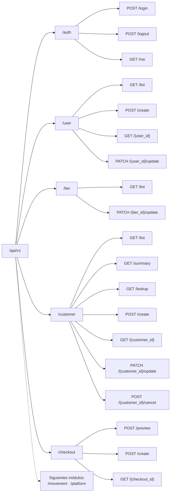

## 5. Inicio y cierre de sesión

### Login

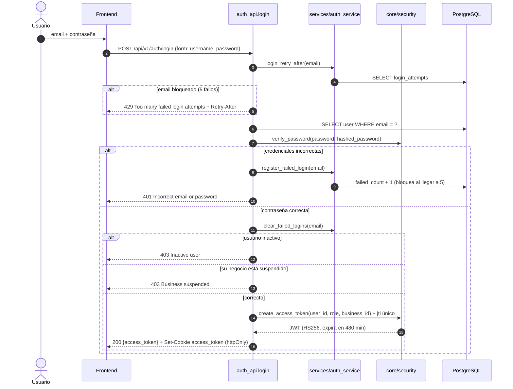

### Límite de intentos (H4)

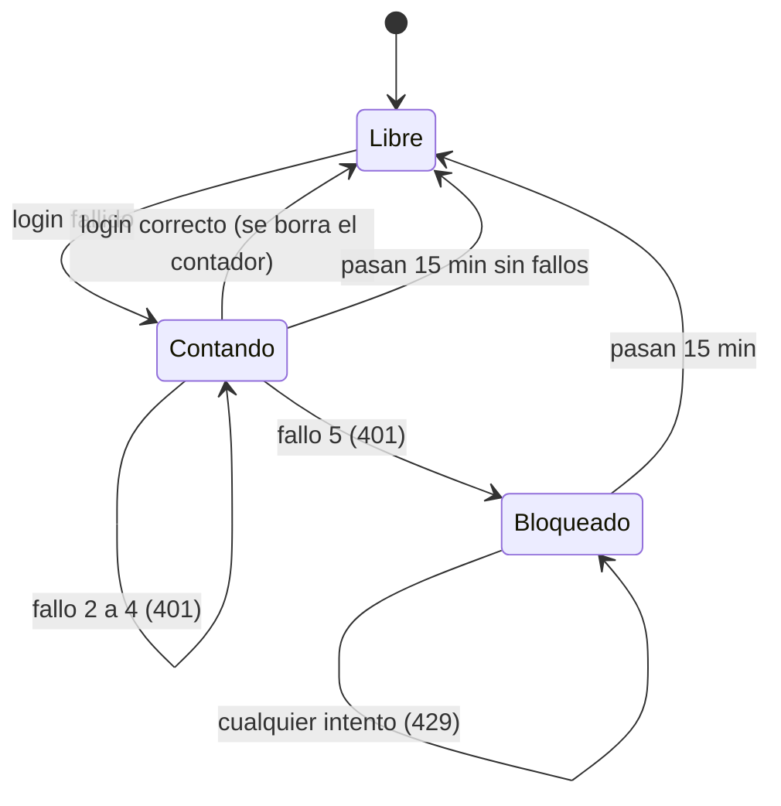

- Es por email, en minúscula, y cuenta igual para emails que no existen, así que no revela cuáles existen.
- Durante el bloqueo, ni la contraseña correcta entra; si no, el bloqueo no frenaría un ataque.
- Configurable con `LOGIN_MAX_ATTEMPTS` (5) y `LOGIN_LOCKOUT_MINUTES` (15).
- Contra: alguien que conozca un email puede bloquearlo 15 minutos a propósito. Se acepta para el MVP; la alternativa (contar por IP) no es confiable detrás del proxy de Cloudflare y Coolify.

### Logout (H2)

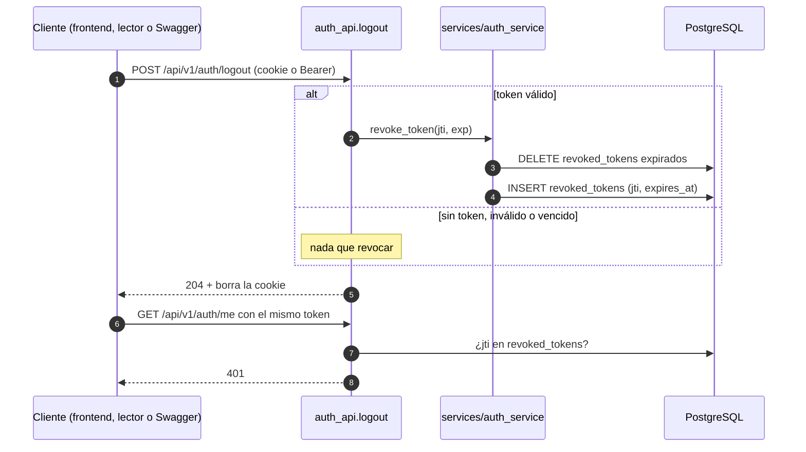

Un JWT no se puede "borrar": sigue siendo válido hasta su `exp`. Por eso cada token lleva un `jti` único y el logout lo guarda en `revoked_tokens`. Solo se cierra **esa** sesión; si el usuario entró desde otro equipo, esa otra sesión sigue abierta. Los tokens emitidos antes de este cambio no tienen `jti` y se rechazan: hay que volver a iniciar sesión una vez.

## 6. Petición autenticada y aislamiento entre negocios

Toda ruta protegida pasa por las dependencias de `api/v1/dependencies.py`. Si el recurso pertenece a otro negocio se responde **404**, igual que si no existiera, para no revelar que existe.

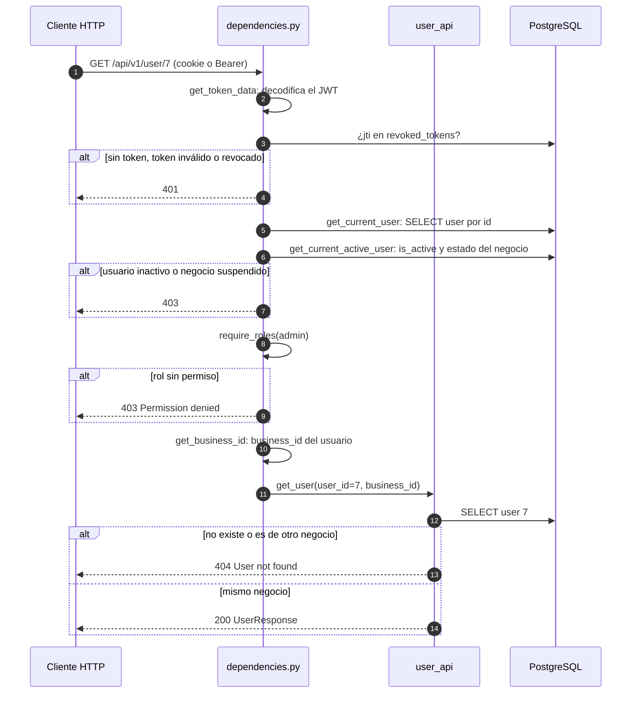

### Cadena de dependencias

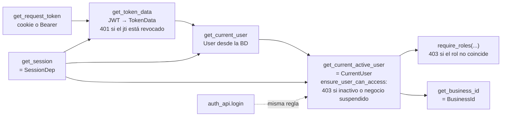

## 7. Arranque de la aplicación

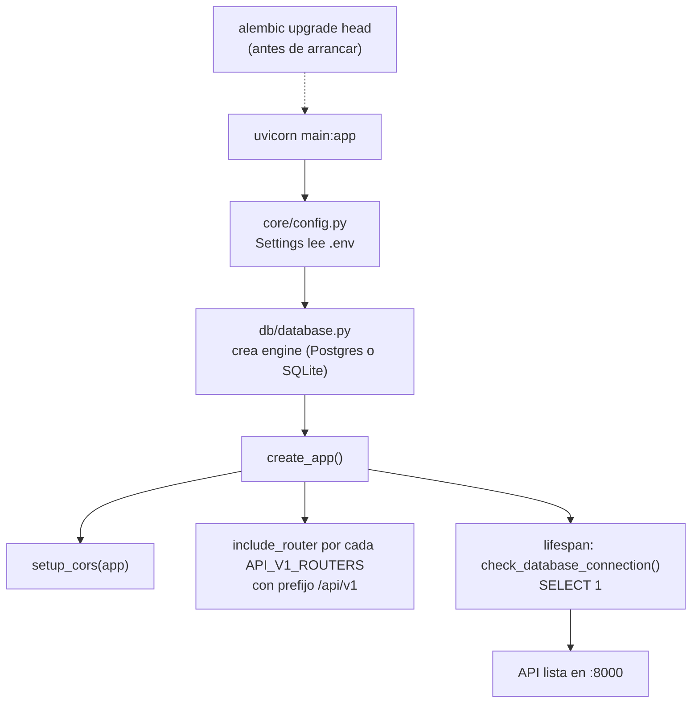

La app **no crea tablas**: el esquema lo maneja Alembic. Detalle en [MIGRATIONS.md](MIGRATIONS.md).

## 8. Cómo agregar un módulo nuevo

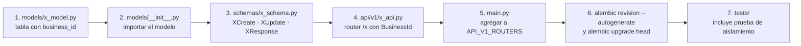

Reglas para todos los módulos:

- Toda tabla de datos de negocio lleva `business_id` y toda consulta filtra por `BusinessId`.
- `business_id` nunca aparece en un schema de entrada (`XCreate`, `XUpdate`).
- Un recurso de otro negocio responde 404.
- Los schemas de salida nunca exponen campos sensibles (`hashed_password`, tokens).
- Los nombres de personas (clientes incluidos) usan `PersonName`.
- Todo `Enum` de un modelo se declara con `sa_type=sa.Enum(X, name="x", values_callable=enum_values)` para guardarse en minúscula.
