# Arquitectura del backend — Member+

Documentación del backend (este repositorio). Los diagramas están en [Mermaid](https://mermaid.js.org/) y se ven directamente en GitHub y en VS Code (con la extensión *Markdown Preview Mermaid Support*).

> El código está en inglés; esta documentación, en español. Cuando un nombre aparece `así`, es el nombre exacto en el código.

## 1. Vista general

Member+ es un SaaS multi-negocio: un solo despliegue atiende a varios negocios (`Business`). Cada dato de negocio lleva `business_id`, y ese valor **siempre sale del token** del usuario, nunca del cuerpo de la petición.

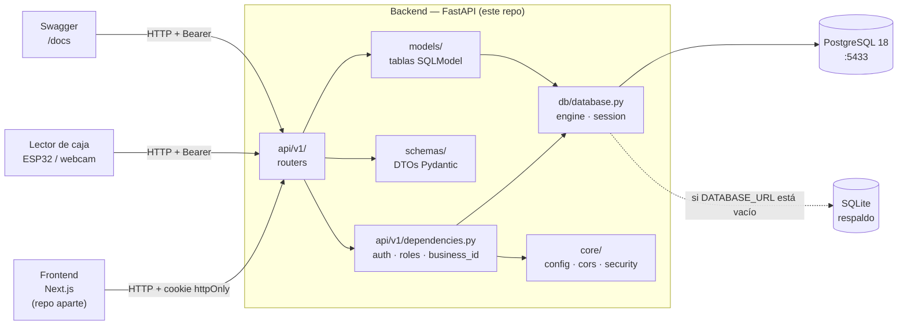

## 2. Estructura de carpetas

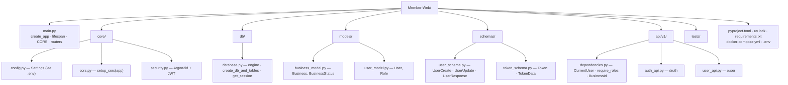

## 3. Modelo de datos actual

Solo existen las tablas necesarias para autenticación. Clientes, tarjetas, niveles, compras y movimientos se agregan en los hitos H1 y H2 del MVP.

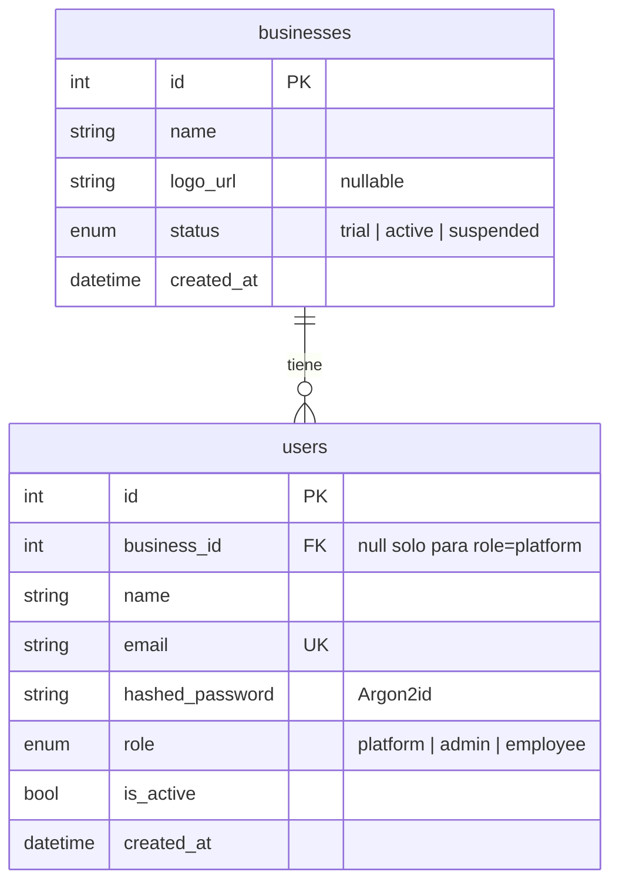

### Roles

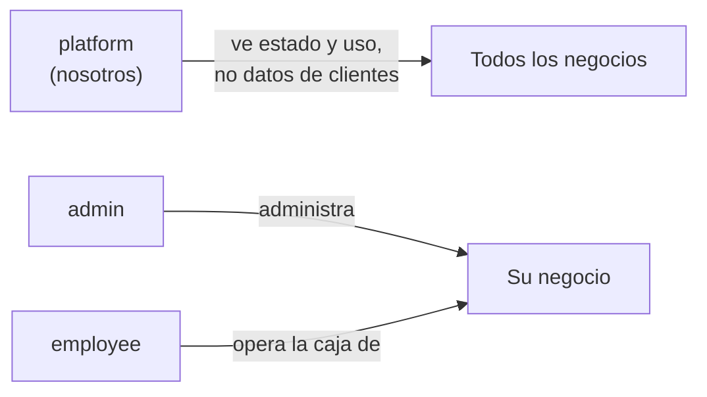

### Estados de un negocio

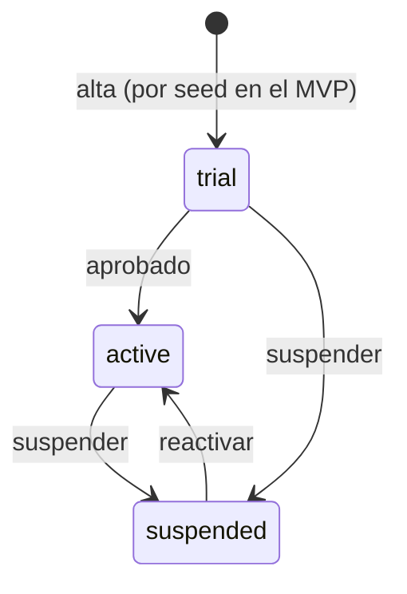

## 4. Endpoints

Prefijo común: `/api/v1`. Documentación interactiva en `http://127.0.0.1:8000/docs`.

| Método | Ruta | Rol requerido | Qué hace |
|--------|------|---------------|----------|
| GET | `/health` | — | Estado de la API |
| POST | `/api/v1/auth/login` | — | Login con email y contraseña; deja cookie y devuelve el token |
| POST | `/api/v1/auth/logout` | — | Borra la cookie de sesión |
| GET | `/api/v1/auth/me` | cualquier usuario activo | Usuario de la sesión |
| GET | `/api/v1/user/list` | admin | Usuarios de su negocio |
| POST | `/api/v1/user/create` | admin | Crea un admin o employee en su negocio |
| GET | `/api/v1/user/{user_id}` | admin | Detalle de un usuario de su negocio |
| PATCH | `/api/v1/user/{user_id}/update` | admin | Edita nombre, email, contraseña o `is_active` |

**Convención de rutas:** `/<recurso en singular>/<acción>` (`/user/create`, `/user/list`, `/user/{id}/update`). Los módulos nuevos siguen la misma forma, por ejemplo `/customer/create`.

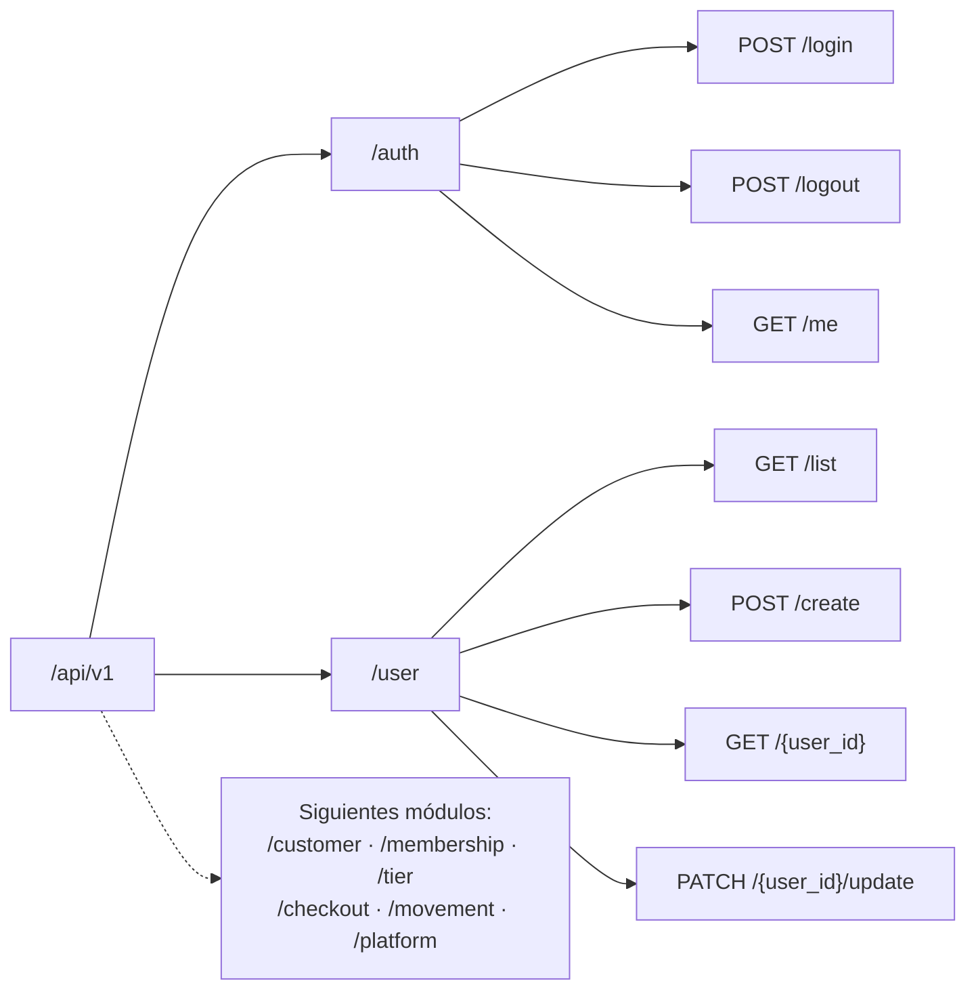

## 5. Inicio de sesión

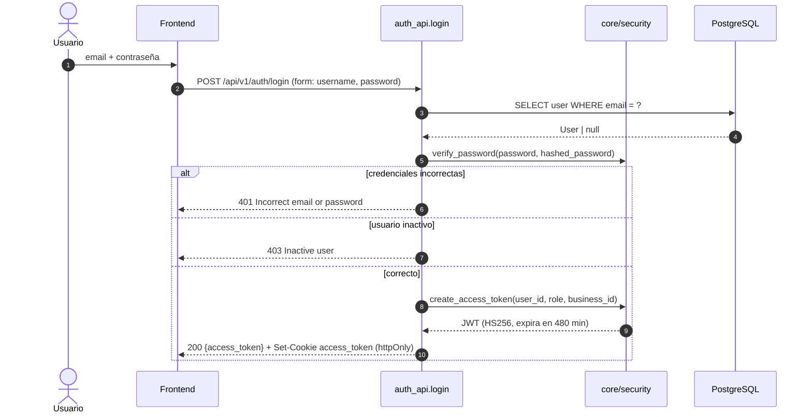

## 6. Petición autenticada y aislamiento entre negocios

Toda ruta protegida pasa por las dependencias de `api/v1/dependencies.py`. Si el recurso pertenece a otro negocio se responde **404**, igual que si no existiera, para no revelar que existe.

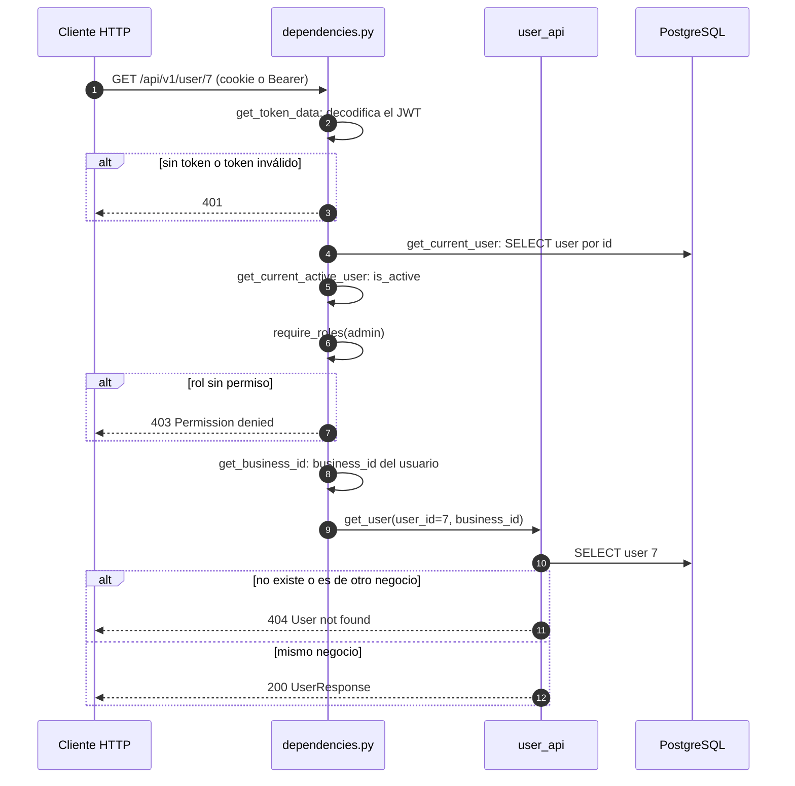

### Cadena de dependencias

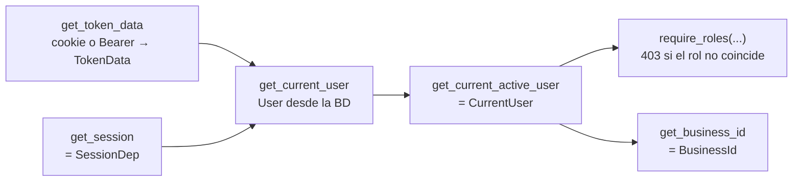

## 7. Arranque de la aplicación

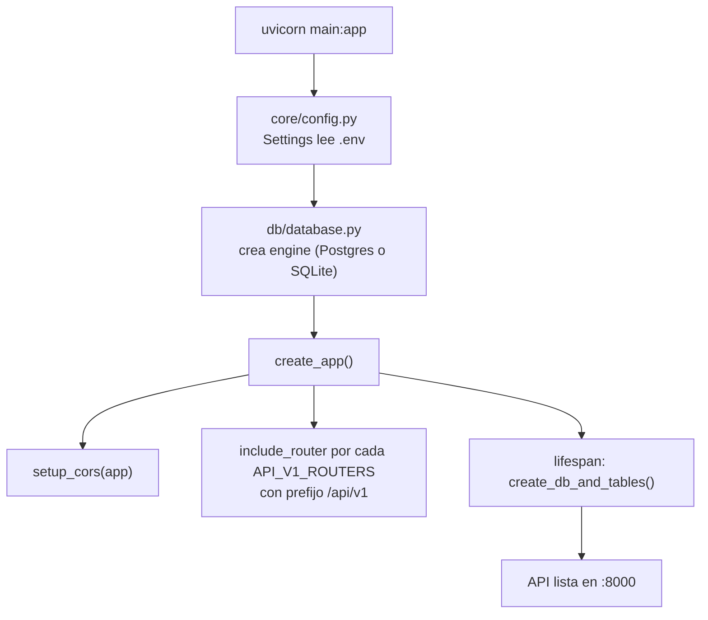

## 8. Cómo agregar un módulo nuevo

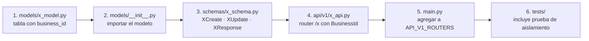

Reglas para todos los módulos:

- Toda tabla de datos de negocio lleva `business_id` y toda consulta filtra por `BusinessId`.
- `business_id` nunca aparece en un schema de entrada (`XCreate`, `XUpdate`).
- Un recurso de otro negocio responde 404.
- Los schemas de salida nunca exponen campos sensibles (`hashed_password`, tokens).
