# Arquitectura del backend — Member+

Documentación del backend (este repositorio). Los diagramas están en [Mermaid](https://mermaid.js.org/) y se ven directamente en GitHub y en VS Code (con la extensión *Markdown Preview Mermaid Support*).

> El código está en inglés; esta documentación, en español. Cuando un nombre aparece `así`, es el nombre exacto en el código.

## 1. Vista general

Member+ es un SaaS multi-negocio: un solo despliegue atiende a varios negocios (`Business`). Cada dato de negocio lleva `business_id`, y ese valor **siempre sale del token** del usuario, nunca del cuerpo de la petición.

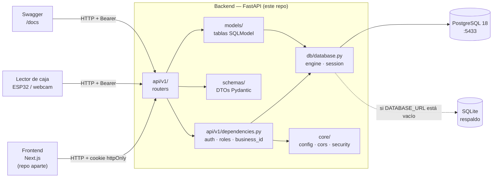

## 2. Estructura de carpetas

```mermaid
flowchart TB
    ROOT["Member-Web/"]
    ROOT --> MAIN["main.py<br/>create_app · lifespan · CORS · routers"]
    ROOT --> CORE["core/"]
    ROOT --> DBF["db/"]
    ROOT --> MOD["models/"]
    ROOT --> SCH["schemas/"]
    ROOT --> API["api/v1/"]
    ROOT --> SRV["services/"]
    ROOT --> SCR["scripts/"]
    ROOT --> MIGR["migrations/"]
    ROOT --> TST["tests/"]
    ROOT --> CFG["pyproject.toml · uv.lock · alembic.ini<br/>docker-compose.yml · .env"]

    CORE --> C1["config.py — Settings (lee .env)"]
    CORE --> C2["cors.py — setup_cors(app)"]
    CORE --> C3["security.py — Argon2id + JWT"]
    DBF --> D1["database.py — engine · check_database_connection · get_session"]
    MIGR --> MG1["env.py — conecta Alembic con settings y models"]
    MIGR --> MG2["versions/ — una migración por cambio"]
    MOD --> M1["business_model.py — Business, BusinessStatus"]
    MOD --> M2["user_model.py — User, Role"]
    MOD --> M3["enum_utils.py — enum_values (enums en minúscula)"]
    MOD --> M4["revoked_token_model.py — RevokedToken"]
    MOD --> M5["login_attempt_model.py — LoginAttempt"]
    SRV --> SV1["auth_service.py — revocación de tokens · límite de login"]
    SCR --> SC1["seed.py — 2 negocios demo y sus usuarios"]
    SCH --> S1["user_schema.py — UserCreate · UserUpdate · UserResponse · MeResponse"]
    SCH --> S4["business_schema.py — BusinessSummaryResponse"]
    SCH --> S2["token_schema.py — Token · TokenData"]
    SCH --> S3["validators.py — PersonName"]
    API --> A1["dependencies.py — CurrentUser · require_roles · BusinessId<br/>ensure_user_can_access"]
    API --> A2["auth_api.py — /auth"]
    API --> A3["user_api.py — /user"]
```

## 3. Modelo de datos actual

Solo existen las tablas necesarias para autenticación; `python -m scripts.seed` las llena con dos negocios de demo (Café Aurora y Gimnasio Titán) y sus usuarios. Clientes, tarjetas, niveles, compras y movimientos se agregan en los hitos H1 y H2 del MVP.

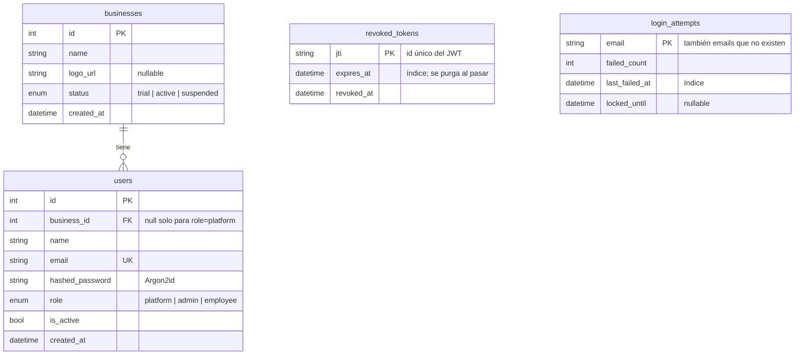

`revoked_tokens` (H2) y `login_attempts` (H4) son tablas de seguridad, no datos de un negocio: no llevan `business_id` ni se relacionan con `users`. Se limpian solas: un token revocado se borra cuando ya habría expirado, y un registro de intentos se borra al iniciar sesión bien o cuando pasa la ventana de bloqueo.

### Roles

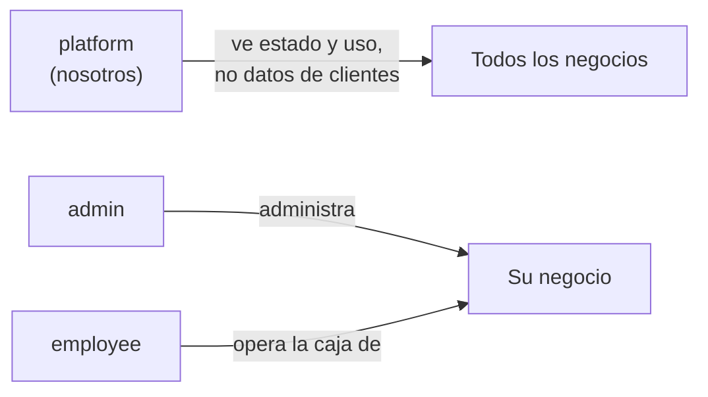

### Estados de un negocio

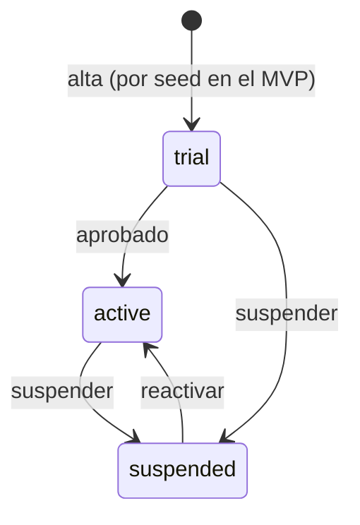

| Estado | ¿Sus usuarios pueden entrar? |
|--------|------------------------------|
| `trial` | Sí |
| `active` | Sí |
| `suspended` | **No**: 403 `Business suspended` en el login y en cualquier petición, aunque ya tengan sesión abierta |

En la base los valores de los `ENUM` se guardan en minúscula (`'admin'`, `'suspended'`), igual que en la API. Ver [MIGRATIONS.md](MIGRATIONS.md#7-migraciones-existentes).

## 4. Endpoints

Prefijo común: `/api/v1`. Documentación interactiva en `http://127.0.0.1:8000/docs`.

| Método | Ruta | Rol requerido | Qué hace |
|--------|------|---------------|----------|
| GET | `/health` | — | Estado de la API |
| POST | `/api/v1/auth/login` | — | Login con email y contraseña; deja cookie y devuelve el token. Tras 5 intentos fallidos por email responde 429 durante 15 min |
| POST | `/api/v1/auth/logout` | — | Revoca el token de esta sesión (cookie o Bearer) y borra la cookie. Las demás sesiones del usuario siguen abiertas |
| GET | `/api/v1/auth/me` | cualquier usuario activo | Usuario de la sesión y su negocio (`business`: `id`, `name`, `logo_url`, `status`; `null` para `platform`) |
| GET | `/api/v1/user/list` | admin | Usuarios de su negocio |
| POST | `/api/v1/user/create` | admin | Crea un admin o employee en su negocio |
| GET | `/api/v1/user/{user_id}` | admin | Detalle de un usuario de su negocio |
| PATCH | `/api/v1/user/{user_id}/update` | admin | Edita nombre, email, contraseña o `is_active`. Un admin no puede desactivarse a sí mismo (400) |

**Respuesta de `/auth/me`** (`MeResponse`): los campos de `UserResponse` más `business`, el resumen del negocio que el frontend muestra en el encabezado del panel y de la caja. No incluye datos de uso ni de clientes.

```json
{
  "id": 3,
  "business_id": 1,
  "name": "Luis Pérez",
  "email": "caja@cafe-aurora.mx",
  "role": "employee",
  "is_active": true,
  "created_at": "2026-11-12T23:28:01.536737Z",
  "business": { "id": 1, "name": "Café Aurora", "logo_url": null, "status": "active" }
}
```

**Validación de nombres** (`PersonName`, `schemas/validators.py`): se quitan los espacios sobrantes; solo letras (con acentos y ñ), espacios, guion y apóstrofo; mínimo 2 letras y máximo 120 caracteres. Si no se cumple → 422.

**Convención de rutas:** `/<recurso en singular>/<acción>` (`/user/create`, `/user/list`, `/user/{id}/update`). Los módulos nuevos siguen la misma forma, por ejemplo `/customer/create`.

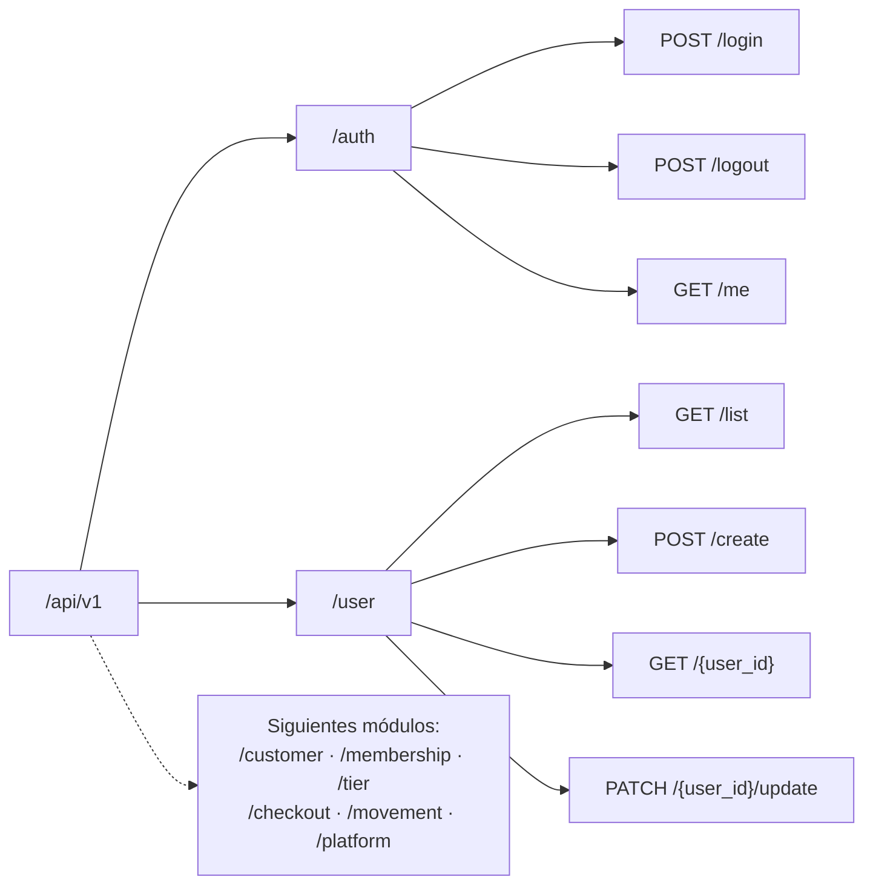

## 5. Inicio y cierre de sesión

### Login

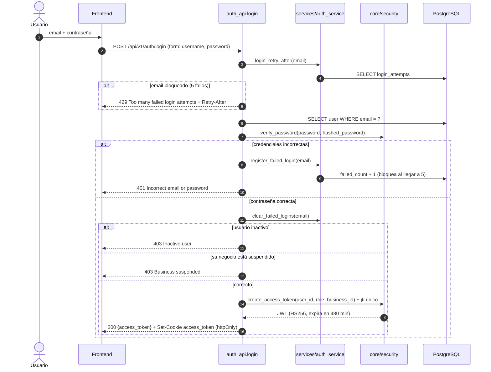

### Límite de intentos (H4)

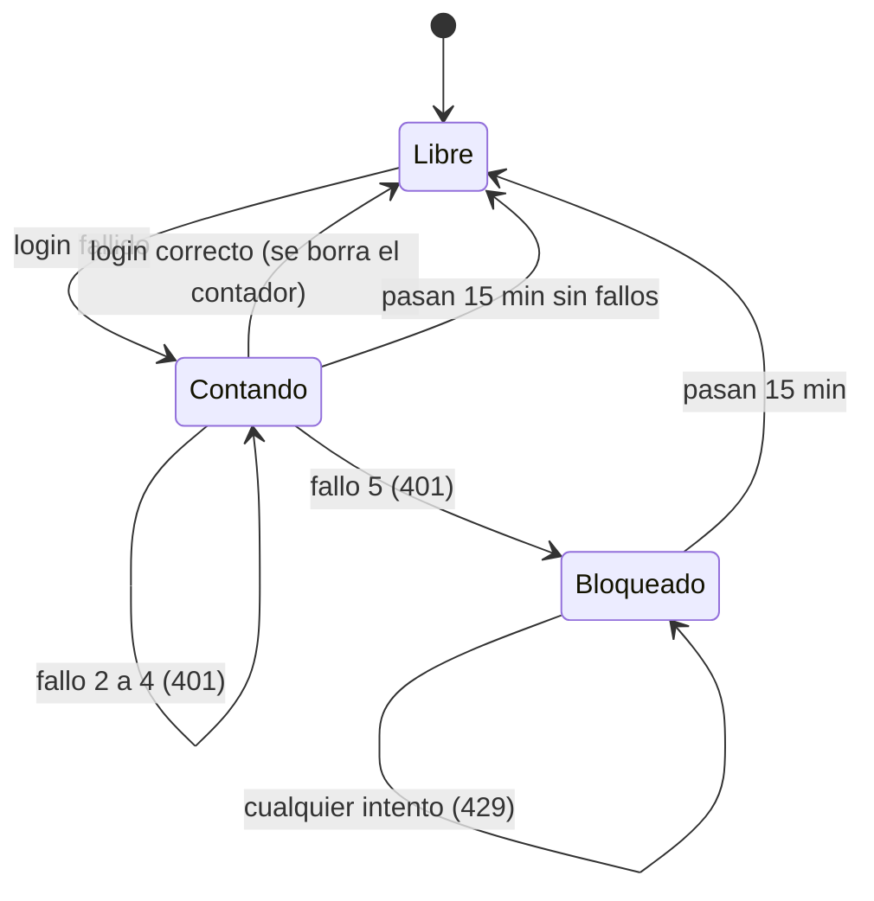

- Es por email, en minúscula, y cuenta igual para emails que no existen, así que no revela cuáles existen.
- Durante el bloqueo, ni la contraseña correcta entra; si no, el bloqueo no frenaría un ataque.
- Configurable con `LOGIN_MAX_ATTEMPTS` (5) y `LOGIN_LOCKOUT_MINUTES` (15).
- Contra: alguien que conozca un email puede bloquearlo 15 minutos a propósito. Se acepta para el MVP; la alternativa (contar por IP) no es confiable detrás del proxy de Cloudflare y Coolify.

### Logout (H2)

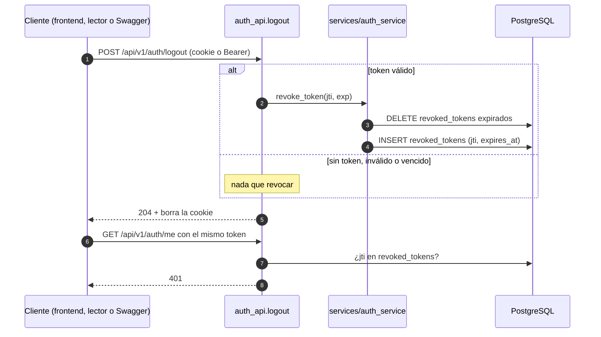

Un JWT no se puede "borrar": sigue siendo válido hasta su `exp`. Por eso cada token lleva un `jti` único y el logout lo guarda en `revoked_tokens`. Solo se cierra **esa** sesión; si el usuario entró desde otro equipo, esa otra sesión sigue abierta. Los tokens emitidos antes de este cambio no tienen `jti` y se rechazan: hay que volver a iniciar sesión una vez.

## 6. Petición autenticada y aislamiento entre negocios

Toda ruta protegida pasa por las dependencias de `api/v1/dependencies.py`. Si el recurso pertenece a otro negocio se responde **404**, igual que si no existiera, para no revelar que existe.

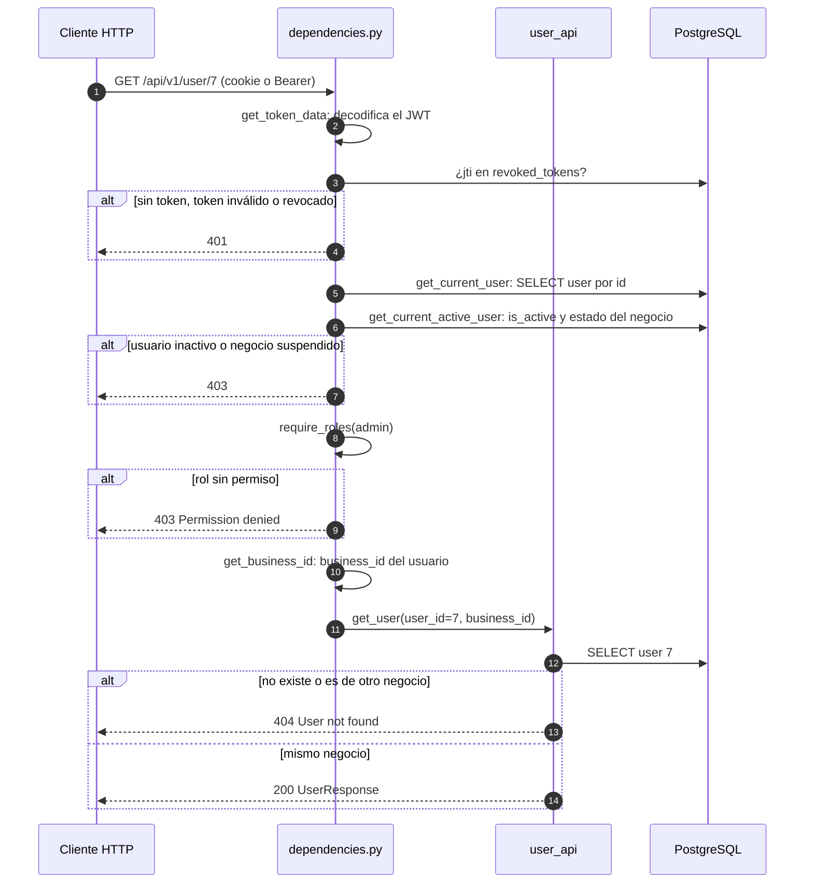

### Cadena de dependencias

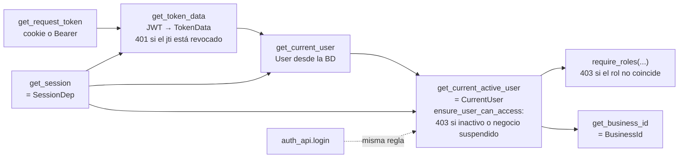

## 7. Arranque de la aplicación

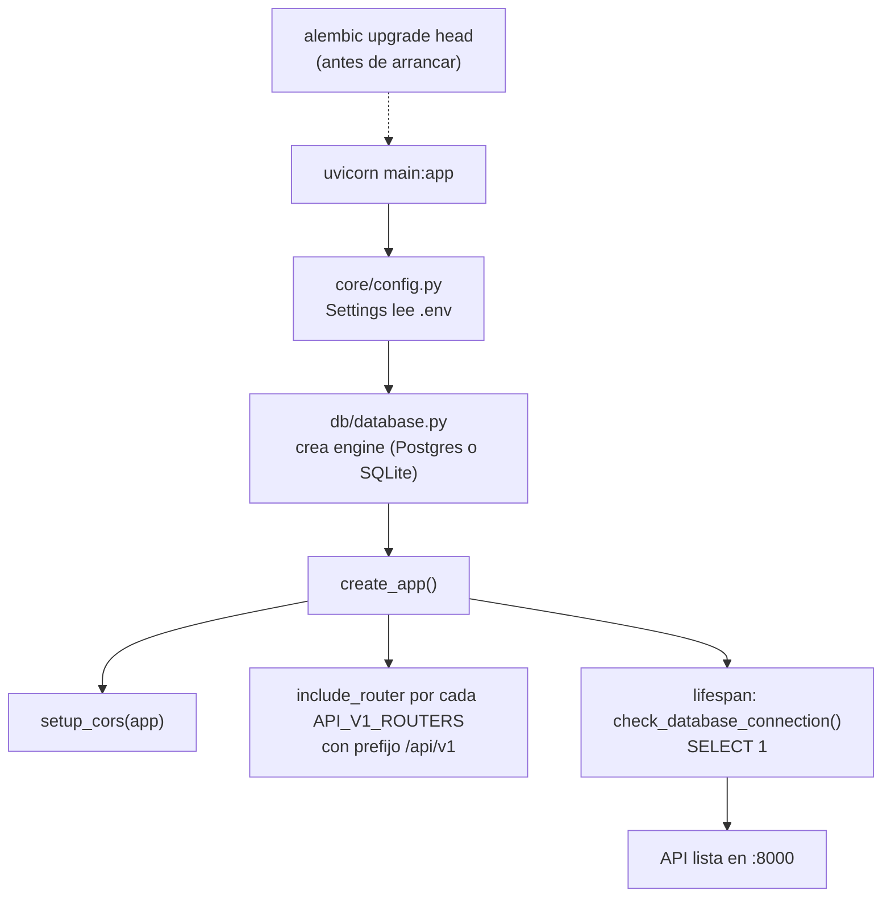

La app **no crea tablas**: el esquema lo maneja Alembic. Detalle en [MIGRATIONS.md](MIGRATIONS.md).

## 8. Cómo agregar un módulo nuevo

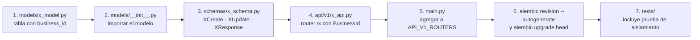

Reglas para todos los módulos:

- Toda tabla de datos de negocio lleva `business_id` y toda consulta filtra por `BusinessId`.
- `business_id` nunca aparece en un schema de entrada (`XCreate`, `XUpdate`).
- Un recurso de otro negocio responde 404.
- Los schemas de salida nunca exponen campos sensibles (`hashed_password`, tokens).
- Los nombres de personas (clientes incluidos) usan `PersonName`.
- Todo `Enum` de un modelo se declara con `sa_type=sa.Enum(X, name="x", values_callable=enum_values)` para guardarse en minúscula.
