# Arquitectura del backend — Member+

Documentación del backend (este repositorio). Los diagramas están en [Mermaid](https://mermaid.js.org/) y se ven directamente en GitHub y en VS Code (con la extensión *Markdown Preview Mermaid Support*).

> El código está en inglés; esta documentación, en español. Cuando un nombre aparece `así`, es el nombre exacto en el código.

## 1. Vista general

Member+ es un SaaS multi-negocio: un solo despliegue atiende a varios negocios (`Business`). Cada dato de negocio lleva `business_id`, y ese valor **siempre sale del token** del usuario, nunca del cuerpo de la petición.

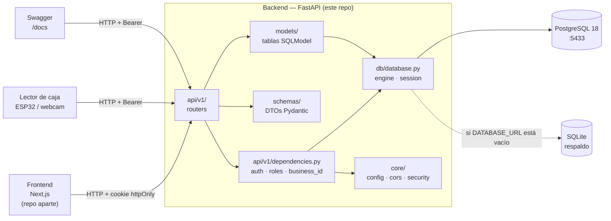

## 2. Estructura de carpetas

```mermaid
flowchart TB
    ROOT["Member-Web/"]
    ROOT --> MAIN["main.py<br/>create_app · lifespan · CORS · routers"]
    ROOT --> CORE["core/"]
    ROOT --> DBF["db/"]
    ROOT --> MOD["models/"]
    ROOT --> SCH["schemas/"]
    ROOT --> API["api/v1/"]
    ROOT --> SRV["services/"]
    ROOT --> SCR["scripts/"]
    ROOT --> MIGR["migrations/"]
    ROOT --> TST["tests/"]
    ROOT --> CFG["pyproject.toml · uv.lock · alembic.ini<br/>docker-compose.yml · .env"]

    CORE --> C1["config.py — Settings (lee .env)"]
    CORE --> C2["cors.py — setup_cors(app)"]
    CORE --> C3["security.py — Argon2id + JWT"]
    CORE --> C4["errors.py — ApiError · ErrorCode (code estable en errores)"]
    CORE --> C5["rate_limit.py — SlidingWindowLimiter (límite por IP en memoria)"]
    DBF --> D1["database.py — engine · check_database_connection · get_session"]
    DBF --> D2["rls.py — Row Level Security: rol memberplus_tenant · activate"]
    MIGR --> MG1["env.py — conecta Alembic con settings y models"]
    MIGR --> MG2["versions/ — una migración por cambio"]
    MOD --> M1["business_model.py — Business, BusinessStatus"]
    MOD --> M2["user_model.py — User, Role"]
    MOD --> M3["enum_utils.py — enum_values (enums en minúscula)"]
    MOD --> M4["revoked_token_model.py — RevokedToken"]
    MOD --> M5["login_attempt_model.py — LoginAttempt"]
    MOD --> M6["tier_model.py — Tier, TierFinish"]
    MOD --> M7["customer_model.py — Customer (cliente y su tarjeta)"]
    MOD --> M8["purchase_model.py — Purchase (compra = movimiento = comprobante)"]
    MOD --> M9["card_delivery_model.py — CardDelivery (enlace a la tarjeta digital)"]
    MOD --> M10["card_email_model.py — CardEmail (envíos, para el límite)"]
    MOD --> M11["membership_payment_model.py — MembershipPayment, PaymentMethod, PaymentKind"]
    SRV --> SVL1["logo_service.py — subir · reemplazar · quitar el logo"]
    SRV --> SVB["business_service.py — nombre, vigencia y color del negocio del token"]
    SRV --> SVC["color_service.py — texto legible sobre el color (contraste WCAG)"]
    SRV --> SVL4["upload_service.py — reemplazar o quitar una imagen (logo y fotos)"]
    SRV --> SVL5["profile_service.py — foto de perfil del usuario en sesión"]
    SRV --> SVL2["image_service.py — validar · WebP 512 px sin EXIF"]
    SRV --> SVL3["storage_service.py — bucket S3 · URLs firmadas"]
    SRV --> SV1["auth_service.py — revocación de tokens · límite de login"]
    SRV --> SV2["tier_service.py — listar y editar niveles · reglas de rango"]
    SRV --> SV3["customer_service.py — clientes · código · estado · saldos · paginación"]
    SRV --> SV4["pricing_service.py — fórmula de caja (pura)"]
    SRV --> SV5["checkout_service.py — cobrar · comprobante · Idempotency-Key"]
    SRV --> SV6["movement_service.py — historial · totales · CSV"]
    SRV --> SV7["platform_service.py — negocios vistos por la plataforma"]
    SRV --> SV8["card_service.py — enlace · correo · tarjeta pública"]
    SRV --> SV9["email_service.py — SMTP con plazo máximo · bandeja en memoria"]
    SRV --> SV10["wallet_service.py — JWT de Google Wallet"]
    SRV --> SV11["payment_service.py — pagos de membresía"]
    SRV --> SV12["turnstile_service.py — Cloudflare Turnstile en el login"]
    SCR --> SC1["seed.py — 2 negocios demo, usuarios, niveles, clientes, compras y un enlace"]
    SCR --> SC2["simulate.py — historial de demo (--bulk) y compra suelta para la tarea programada (--tick)"]
    SCH --> S1["user_schema.py — UserCreate · UserUpdate · UserResponse · MeResponse"]
    SCH --> S4["business_schema.py — BusinessUpdate · BusinessSummaryResponse"]
    SCH --> S2["token_schema.py — Token · TokenData"]
    SCH --> S3["validators.py — PersonName"]
    SCH --> S5["tier_schema.py — TierUpdate · TierResponse"]
    SCH --> S6["customer_schema.py — CustomerCreate · CustomerUpdate · CustomerResponse"]
    SCH --> S7["pagination_schema.py — PageResponse"]
    SCH --> S8["checkout_schema.py — CheckoutCreate · ReceiptResponse"]
    SCH --> S9["movement_schema.py — MovementResponse · MovementPageResponse"]
    SCH --> S10["platform_schema.py — PlatformBusinessResponse · PlatformBusinessDetailResponse · PlatformBusinessUpdate · PlatformSummaryResponse"]
    SCH --> S11["card_schema.py — CardLinkResponse · PublicCardResponse · CustomerCreatedResponse"]
    API --> A1["dependencies.py — CurrentUser · require_permission · BusinessId<br/>ensure_user_can_access"]
    API --> A2["auth_api.py — /auth"]
    API --> AL["logo_api.py — /logo"]
    API --> AB["business_api.py — /business"]
    API --> AP["profile_api.py — /user/photo"]
    API --> AU["uploads.py — límite de 2 MB y códigos de error de las subidas"]
    API --> A3["user_api.py — /user"]
    API --> A4["tier_api.py — /tier"]
    API --> A5["customer_api.py — /customer"]
    API --> A6["checkout_api.py — /checkout"]
    API --> A7["movement_api.py — /movement"]
    API --> A8["platform_api.py — /platform"]
    API --> A9["card_api.py — /card (público, sin sesión)"]
```

## 3. Modelo de datos actual

Existen las tablas de autenticación, los niveles, los clientes con su tarjeta, las compras y la entrega de la tarjeta digital; `python -m scripts.seed` las llena con dos negocios de demo (Café Aurora y Gimnasio Titán), sus usuarios, sus niveles, sus clientes (12 y 2), sus compras (12 y 1) y un enlace activo a la tarjeta `MP-4F7K2` (imprime la URL al crearlo). Para que la demo muestre un sistema vivo, `python -m scripts.simulate --bulk` agrega 84 días de compras retroactivas y 10 clientes por negocio (deterministas, idempotentes: se niega a correr dos veces), y `python -m scripts.simulate --tick` inserta una compra de «ahora» por minuto para la tarea programada de Coolify (ver DEPLOY.md, sección 4).

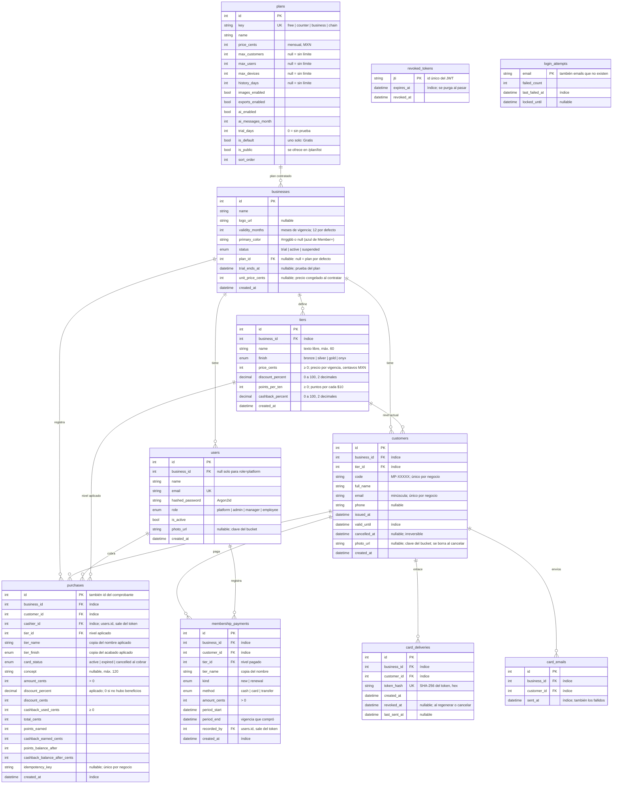

**Niveles (`tiers`).** Cada negocio define los suyos; el seed solo carga una plantilla (Bronce, Plata, Oro y Onyx en Café Aurora; Básico y Premium en Gimnasio Titán). `finish` es el acabado visual de la tarjeta y lo elige el negocio; el nombre es libre. Un beneficio en `0` equivale a deshabilitado para ese nivel. **El cliente sube de nivel pagando** (decisión "por cobro": mejor nivel = más beneficio y más costo), así que cada nivel tiene `price_cents` y no hay umbral de puntos; los puntos solo son un saldo. Los rangos se validan en `services/tier_service.py` (422 `tier_invalid`) y la base los repite con restricciones `CHECK` como última defensa.

`revoked_tokens` (H2) y `login_attempts` (H4) son tablas de seguridad, no datos de un negocio: no llevan `business_id` ni se relacionan con `users`. Se limpian solas: un token revocado se borra cuando ya habría expirado, y un registro de intentos se borra al iniciar sesión bien o cuando pasa la ventana de bloqueo.

### Roles

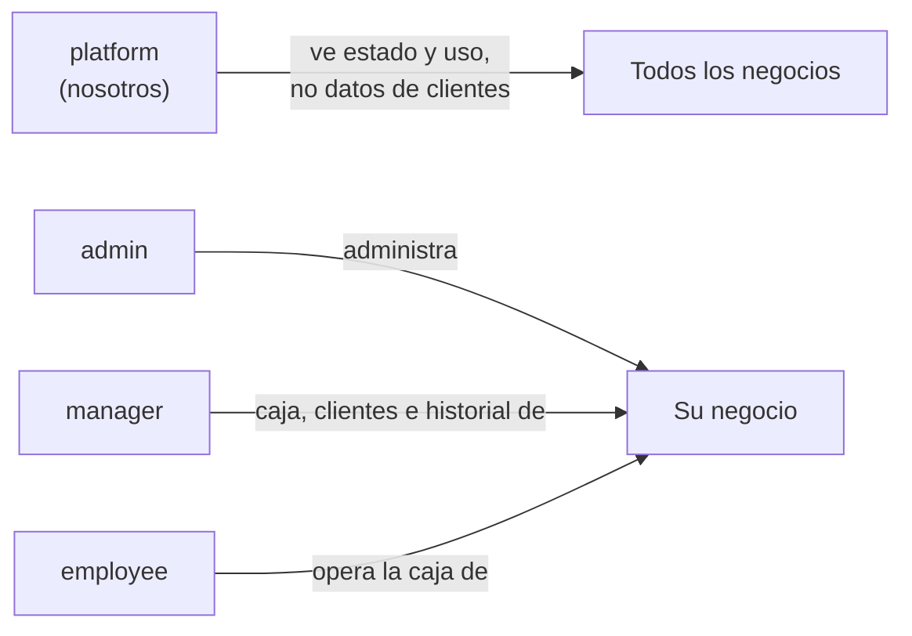

Las rutas no preguntan por el rol sino por un **permiso** (`require_permission(Permission.X)`, en `api/v1/dependencies.py`). Qué permisos tiene cada rol vive en un solo lugar, `core/permissions.py` (issue #72), y `/auth/me` devuelve la lista en `permissions` para que el frontend muestre u oculte por permiso, no por nombre de rol.

| Permiso | Qué abre | platform | admin | manager | employee |
|---------|----------|:--------:|:-----:|:-------:|:--------:|
| `checkout` | Cobrar en caja y leer sus comprobantes | | ✅ | ✅ | ✅ |
| `receipts.all` | Leer cualquier comprobante del negocio, no solo los propios | | ✅ | ✅ | |
| `customers.lookup` | Buscar una tarjeta por su código | | ✅ | ✅ | ✅ |
| `customers.manage` | Listar, crear, editar, renovar y cancelar clientes; foto, pagos y enlace de la tarjeta | | ✅ | ✅ | |
| `movements.read` | Historial de compras, sus totales y el CSV | | ✅ | ✅ | |
| `tiers.read` | Ver los niveles | | ✅ | ✅ | ✅ |
| `tiers.manage` | Editar los niveles | | ✅ | | |
| `users.manage` | Usuarios del negocio | | ✅ | | |
| `business.manage` | Nombre, vigencia, color y logo | | ✅ | | |
| `platform` | Panel de plataforma (estado y uso, nunca datos) | ✅ | | | |

Los roles son fijos en código a propósito: un negocio chico no tiene quién administre permisos por usuario. El rol se fija al crear el usuario y no se cambia después.

### Estados de un negocio

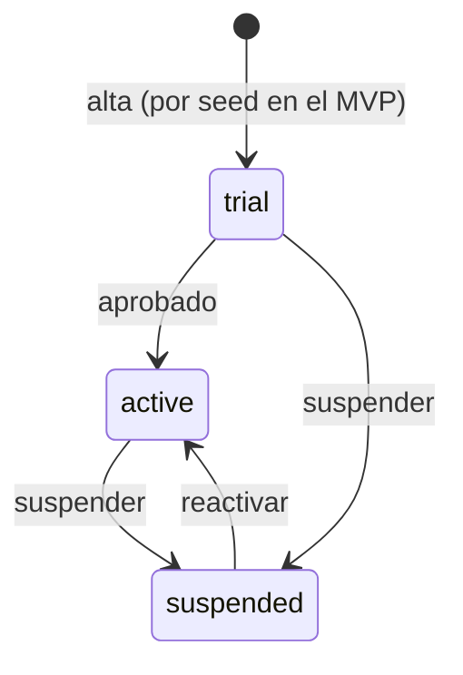

| Estado | ¿Sus usuarios pueden entrar? |
|--------|------------------------------|
| `trial` | Sí |
| `active` | Sí |
| `suspended` | **No**: 403 `Business suspended` en el login y en cualquier petición, aunque ya tengan sesión abierta |

En la base los valores de los `ENUM` se guardan en minúscula (`'admin'`, `'suspended'`), igual que en la API. Ver [MIGRATIONS.md](MIGRATIONS.md#7-migraciones-existentes).

### Planes (issue #70)

`plans` es un catálogo global, sin `business_id` (no lleva RLS; el rol del negocio solo puede leerlo). Cada negocio apunta a uno con `businesses.plan_id`. Lo que aplica en este momento es el **plan efectivo**, que se calcula al leer (`plan_service.effective_plan`) y nunca con un job:

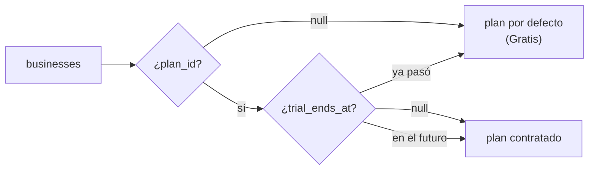

- `status` es acceso y el plan son capacidades: que termine la prueba no suspende al negocio, no borra nada ni apaga tarjetas emitidas.
- Los números del catálogo (`plan_service.CATALOG`) son la sugerencia de arranque de *Planes y límites: propuesta* en la wiki; los fija el equipo. Cambiarlos es una migración nueva, porque el catálogo es dato: la migración `613f061889d5` lleva su propia copia.
- Los negocios que existían antes de esa migración quedaron en el plan `business` sin prueba, para no cerrarles nada de lo que ya usaban. El seed pone a Café Aurora en `business` y a Gimnasio Titán en `counter`.
- Las pruebas cargan el catálogo con `plan_service.ensure_catalog` después de limpiar la base, porque `create_all` crea la tabla vacía.

### Imágenes: logo, foto del cliente y foto de perfil

Tres columnas guardan una imagen, y las tres siguen la misma regla (`services/upload_service.py`):

| Columna | Qué es | Clave en el bucket | Quién la cambia |
|---------|--------|--------------------|-----------------|
| `businesses.logo_url` | Logo del negocio | `businesses/{business_id}/logo/{uuid}.webp` | Admin del negocio (`/logo/update`) |
| `customers.photo_url` | Foto del cliente, **solo para mostrarse** en el panel y en la caja | `businesses/{business_id}/customers/{customer_id}/photo/{uuid}.webp` | Admin del negocio (`/customer/{customer_id}/photo/update`). **Se borra al cancelar la membresía** |
| `users.photo_url` | Foto de perfil | `businesses/{business_id}/users/{user_id}/photo/{uuid}.webp` (el dueño de plataforma, bajo `platform/users/…`) | Cada usuario la suya (`/user/photo/update`) |

La foto del cliente no tiene ningún uso biométrico ni de reconocimiento facial (RF-11 sigue fuera); se permitió el 16 nov 2026 solo para que el empleado reconozca al cliente en la caja.

`businesses.logo_url` guarda una **clave** del bucket (`businesses/{business_id}/logo/{uuid}.webp`) o una URL externa, nunca una URL firmada. La API la convierte al responder: las claves se vuelven URLs firmadas que caducan en 1 h, las URLs externas pasan tal cual y, sin almacenamiento configurado, las claves se reportan como `null`. La imagen subida se valida, se reduce a 512 px y se guarda como WebP sin metadatos. Por eso no hizo falta una tabla ni una migración nueva. Guía completa en [STORAGE.md](STORAGE.md).

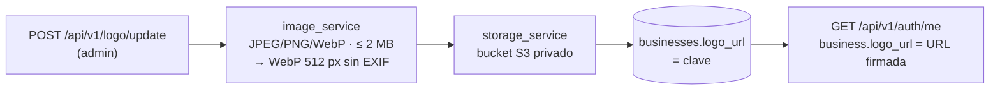

## 4. Endpoints

Prefijo común: `/api/v1`. Documentación interactiva en `http://127.0.0.1:8000/docs`.

| Método | Ruta | Rol requerido | Qué hace |
|--------|------|---------------|----------|
| GET | `/health` | — | Estado de la API |
| POST | `/api/v1/auth/login` | — | Login con email y contraseña; deja cookie y devuelve el token. Tras 5 intentos fallidos por email responde 429 durante 15 min. Con `TURNSTILE_ENABLED` exige la cabecera `X-Turnstile-Token` (400 `turnstile_failed`) |
| POST | `/api/v1/auth/logout` | — | Revoca el token de esta sesión (cookie o Bearer) y borra la cookie. Las demás sesiones del usuario siguen abiertas |
| GET | `/api/v1/auth/me` | cualquier usuario activo | Usuario de la sesión, con su `photo_url` firmada, y su negocio (`business`: `id`, `name`, `logo_url`, `status`, `validity_months`, `primary_color`, `primary_foreground`; `null` para `platform`) |
| PATCH | `/api/v1/business/update` | admin | Configuración del negocio del token (pantalla 13): `name` (2 a 120 caracteres; se quitan los espacios sobrantes) `validity_months` (entero de 1 a 60) y `primary_color` (`#rrggbb`), todos opcionales; ausente no cambia nada y `null` tampoco, salvo en `primary_color`, donde quita el color. Responde el mismo `business` de `/auth/me`. La vigencia nueva aplica a las tarjetas que se emitan o renueven después |
| POST | `/api/v1/user/photo/update` | cualquier usuario activo | Sube o reemplaza **su propia** foto de perfil (`multipart/form-data`, campo `file`). Mismas reglas y errores que `/logo/update`. Devuelve el usuario con `photo_url` firmada |
| POST | `/api/v1/user/photo/delete` | cualquier usuario activo | Quita su propia foto. Sin foto, responde 200 igual |
| POST | `/api/v1/logo/update` | admin | Sube o reemplaza el logo del negocio del token (`multipart/form-data`, campo `file`). JPEG, PNG o WebP de hasta 2 MB; se guarda como WebP de 512 px sin metadatos y borra el anterior. Devuelve el negocio con `logo_url` firmada. 413 `image_too_large`, 422 `image_invalid`, 503 `storage_unavailable` |
| POST | `/api/v1/logo/delete` | admin | Quita el logo y borra el archivo. Repetirlo no cambia nada |
| GET | `/api/v1/user/list` | admin | Usuarios de su negocio |
| POST | `/api/v1/user/create` | admin | Crea un admin, manager o employee en su negocio |
| GET | `/api/v1/user/{user_id}` | admin | Detalle de un usuario de su negocio |
| PATCH | `/api/v1/user/{user_id}/update` | admin | Edita nombre, email, contraseña o `is_active`. Un admin no puede desactivarse a sí mismo (400) |
| GET | `/api/v1/tier/list` | admin, manager, employee | Niveles de su negocio, sin paginar, del más barato al más caro (`price_cents`), con `customers_count` |
| PATCH | `/api/v1/tier/{tier_id}/update` | admin | Edita `name`, `finish`, `price_cents`, `discount_percent`, `points_per_ten`, `cashback_percent` (todos opcionales). Fuera de rango → 422 `tier_invalid` |
| GET | `/api/v1/customer/list` | admin, manager | Clientes paginados por `full_name`. Filtros `q` (nombre, email o código), `level_id`, `status` (`active` \| `expiring` \| `expired` \| `cancelled`), `page`, `page_size` (8 por defecto, máx. 500). Una página que no existe devuelve la última |
| GET | `/api/v1/customer/summary` | admin, manager | Conteos `all`, `active` (incluye las por vencer), `expiring`, `expired`, `cancelled` |
| GET | `/api/v1/customer/lookup` | admin, manager, employee | Tarjeta por `code` (QR o tecleado; ignora espacios y mayúsculas). Responde también para vencidas y canceladas. 404 `customer_not_found` |
| POST | `/api/v1/customer/create` | admin, manager | Alta con `full_name`, `email`, `phone` y `level_id` opcionales. Genera `code`, `issued_at` y `valid_until` (+`validity_months` del negocio). Registra el primer pago (`payment_method` = `cash` \| `card` \| `transfer`, `cash` por defecto; `amount_cents`, por defecto el precio del nivel; 0 no registra pago). Con `send_card_email` (`true` por defecto) envía el enlace a la tarjeta; la respuesta agrega `card_email.status` (`sent` \| `failed` \| `pending` \| `skipped`) y un correo fallido no falla el alta. 409 `email_taken` |
| GET | `/api/v1/customer/{customer_id}` | admin, manager | Ficha del cliente |
| PATCH | `/api/v1/customer/{customer_id}/update` | admin, manager | Edita `full_name`, `email`, `phone` (`null` lo borra) o `level_id` (cambio de nivel). 409 `email_taken` |
| POST | `/api/v1/customer/{customer_id}/cancel` | admin, manager | Cancela la tarjeta, revoca su enlace y **borra su foto**; irreversible y repetirlo no cambia nada |
| POST | `/api/v1/customer/{customer_id}/photo/update` | admin, manager | Sube o reemplaza la foto del cliente (`multipart/form-data`, campo `file`), solo para mostrarse. JPEG, PNG o WebP de hasta 2 MB → WebP de 512 px sin metadatos. Devuelve el cliente con `photo_url` firmada. 404 si es de otro negocio, 409 `customer_cancelled`, 413 `image_too_large`, 422 `image_invalid`, 503 `storage_unavailable` |
| POST | `/api/v1/customer/{customer_id}/photo/delete` | admin, manager | Quita la foto del cliente. Sin foto, responde 200 igual |
| POST | `/api/v1/customer/{customer_id}/renew` | admin, manager | Renueva `validity_months` meses: desde `valid_until` si sigue vigente, desde hoy si venció. Cuerpo opcional: `level_id` (cambia de nivel), `payment_method`, `amount_cents` (por defecto el precio del nivel; 0 no registra pago). 409 `customer_cancelled` |
| GET | `/api/v1/customer/{customer_id}/payment/list` | admin, manager | Pagos de membresía del cliente, el más reciente primero, paginados: `kind` (`new` \| `renewal`), `method`, `amount_cents`, `level` {`id`, `name` con que se pagó}, `period_start`, `period_end`, `recorded_by_name` |
| POST | `/api/v1/customer/{customer_id}/card-link` | admin, manager | Enlace nuevo a la tarjeta digital (`url`, `expires_at` = `valid_until`); revoca el anterior. 409 `customer_cancelled` o `customer_expired` |
| POST | `/api/v1/customer/{customer_id}/card-link/send` | admin, manager | Envía por correo un enlace nuevo (`sent_to`, `last_sent_at`). 429 `card_email_rate_limited`, 502 `email_failed` |
| POST | `/api/v1/checkout/preview` | admin, manager, employee | Mismo cuerpo que `create`; calcula y no guarda nada |
| POST | `/api/v1/checkout/create` | admin, manager, employee | Registra la compra (`customer_id`, `amount_cents`, `concept` opcional, `use_cashback`) y devuelve el comprobante (201). Cabecera opcional `Idempotency-Key`. El cajero sale del token |
| GET | `/api/v1/checkout/{checkout_id}` | admin, manager, employee | Comprobante. El cajero solo ve los suyos; el admin y el manager, todos los del negocio (`receipts.all`) |
| GET | `/api/v1/movement/list` | admin, manager | Historial paginado, más reciente primero, con `summary` del conjunto filtrado. Filtros `q`, `customer_id`, `from`, `to` |
| GET | `/api/v1/movement/export` | admin, manager | Mismos filtros que `list`, sin paginar, como CSV descargable |
| GET | `/api/v1/platform/business/list` | platform | Negocios con su estado, `customers_count` y `logo_url` firmada (misma regla que `/auth/me`), paginados por nombre. Filtros `q` y `status`. Nunca datos de clientes |
| GET | `/api/v1/platform/business/summary` | platform | Resumen para el panel de plataforma: negocios por estado (`all`, `trial`, `active`, `suspended`), `customers_count` (tarjetas no canceladas) y `users_count` (usuarios activos) de todos los negocios. Solo conteos |
| GET | `/api/v1/platform/business/{business_id}` | platform | Detalle del negocio: lo de la lista más `validity_months` y `users_count` (usuarios activos). 404 `business_not_found` |
| PATCH | `/api/v1/platform/business/{business_id}/update` | platform | Suspende o reactiva: cuerpo `{"status": "suspended" \| "active"}`; responde el detalle. Suspender corta las sesiones abiertas del negocio. 404 `business_not_found` |
| GET | `/api/v1/card/{token}` | — (público) | Tarjeta pública del enlace: negocio (con su color), nombre, código, nivel, vigencia y `wallet.google`. 404 `card_link_not_found` |
| GET | `/api/v1/card/{token}/google-wallet` | — (público) | `save_url` firmado para guardar la tarjeta en Google Wallet. 503 `wallet_unavailable` sin configuración |
| GET | `/api/v1/public/logo/{business_id}.png` | — (público) | Logo del negocio como PNG cuadrado de 1024 px con 15 % de margen: lo cargan el pase de Google Wallet, el correo de la tarjeta y la tarjeta pública (`/card/{token}`), que no pueden usar una URL firmada que caduca en 1 h. `Cache-Control` de un día (la URL lleva `?v=` con la huella de la clave). 404 sin logo, con negocio suspendido, sin almacenamiento o si el archivo no se puede leer |
| GET | `/api/v1/plan/list` | — (público) | Catálogo de planes que se ofrecen (`is_public`), del más barato al más caro: `key`, `name`, `price_cents`, límites (`max_customers`, `max_users`, `max_devices`, `history_days`; `null` = sin límite), capacidades (`images_enabled`, `exports_enabled`, `ai_enabled`, `ai_messages_month`), `trial_days` e `is_default`. Igual para todos; no trae datos de ningún negocio |

**Respuesta de `/auth/me`** (`MeResponse`): los campos de `UserResponse` más `business`, el resumen del negocio que el frontend muestra en el encabezado del panel y de la caja. No incluye datos de uso ni de clientes.

```json
{
  "id": 3,
  "business_id": 1,
  "name": "Luis Pérez",
  "email": "caja@cafe-aurora.mx",
  "role": "employee",
  "is_active": true,
  "created_at": "2026-11-12T23:28:01.536737Z",
  "photo_url": null,
  "business": { "id": 1, "name": "Café Aurora", "logo_url": null, "status": "active", "validity_months": 12, "primary_color": "#0062f2", "primary_foreground": "#ffffff" },
  "permissions": ["checkout", "customers.lookup", "tiers.read"]
}
```

**Configuración del negocio (`/business`).** Solo el rol `admin`, sobre el negocio de su token: la ruta no recibe id y un `id` o `business_id` en el cuerpo se ignora. Reglas (`services/business_service.py`):

- `PATCH /business/update` cambia `name`, `validity_months` y `primary_color`; lo que no se manda queda igual, y `null` también, salvo en `primary_color`: el color es opcional y `null` lo quita (vuelve el azul de Member+). El estado del negocio lo cambia solo la plataforma y el logo tiene sus propias rutas (`/logo`).
- `validity_months` se lee al emitir o renovar una tarjeta (`customer_service`), así que cambiarlo **no mueve** el `valid_until` de las tarjetas ya emitidas.
- `primary_color` se guarda en minúsculas (`#0062F2` → `#0062f2`); no acepta `#fff`, nombres ni transparencia (422). La respuesta agrega `primary_foreground`, el color de texto legible sobre él: blanco o negro, el que tenga más contraste según WCAG (`services/color_service.py`). El mejor de los dos siempre llega a 4.5:1 (AA), así que no se rechaza ningún color por contraste. Sin color, los dos son `null` y el frontend usa su azul. La tarjeta pública (`/card/{token}`) devuelve los mismos dos campos.
- El rango de 1 a 60 meses y el nombre de 2 a 120 caracteres son validación de campo: un valor fuera responde 422 de FastAPI, sin `code`.

**Errores con código estable** (`core/errors.py`): cada error de negocio responde `{"detail": "...", "code": "..."}`. El frontend elige el mensaje por `code`, así que `detail` se puede redactar distinto sin romperlo. Se lanza con `ApiError(status_code, detail, code)`; `setup_error_handlers(app)` en `main.py` agrega `code` a la respuesta. Los 422 de validación de campos siguen con la forma de FastAPI (`detail` en lista, sin `code`), y los errores que no están en esta tabla (por ejemplo `Permission denied`) solo llevan `detail`.

| `code` | HTTP | Dónde se lanza |
|--------|------|----------------|
| `invalid_credentials` | 401 | `POST /api/v1/auth/login`: email o contraseña incorrectos |
| `login_locked` | 429 | `POST /api/v1/auth/login`: email bloqueado por intentos (con `Retry-After`) |
| `user_inactive` | 403 | `ensure_user_can_access`: usuario desactivado (login y cada petición) |
| `business_suspended` | 403 | `ensure_user_can_access`: negocio suspendido (login y cada petición) |
| `not_authenticated` | 401 | `get_token_data` / `get_current_user`: sin sesión, token inválido, vencido o revocado |
| `email_taken` | 409 | `/user/create` y `/user/{user_id}/update`: email en uso |
| `tier_invalid` | 422 | `/tier/{tier_id}/update`: valor fuera de rango. `/customer/create` y `/customer/{customer_id}/update`: `level_id` inexistente, de otro negocio, o negocio sin niveles |
| `customer_not_found` | 404 | `/customer/lookup`, `/customer/{customer_id}` y sus acciones, `/checkout/create` y `/checkout/preview`: no existe o es de otro negocio |
| `amount_invalid` | 422 | `/checkout/create` y `/checkout/preview`: `amount_cents` fuera de 1 a 100 000 000. `/customer/create` y `/customer/{customer_id}/renew`: `amount_cents` fuera de 0 a 100 000 000. Un monto que no es entero es validación de campo (422 de FastAPI, sin `code`) |
| `checkout_not_found` | 404 | `/checkout/{checkout_id}`: no existe, es de otro negocio, o un cajero pide el comprobante de otro cajero |
| `idempotency_conflict` | 409 | `/checkout/create`: la `Idempotency-Key` ya se usó para otra compra (otro cliente, monto o concepto) |
| `customer_cancelled` | 409 | `/customer/{customer_id}/card-link`, `/send` y `/renew`: la tarjeta está cancelada |
| `customer_expired` | 409 | `/customer/{customer_id}/card-link` y `/send`: la tarjeta venció (el enlace no abriría) |
| `card_email_rate_limited` | 429 | `/customer/{customer_id}/card-link/send`: ya se envió hace menos de 1 minuto o 5 veces en una hora (con `Retry-After`) |
| `email_failed` | 502 | `/customer/{customer_id}/card-link/send`: el proveedor de correo falló |
| `card_link_not_found` | 404 | `/card/{token}` y `/google-wallet`: token desconocido, revocado, tarjeta vencida o cancelada, o negocio suspendido. Siempre el mismo cuerpo |
| `business_not_found` | 404 | `/platform/business/{business_id}` y `/update`: el negocio no existe |
| `wallet_unavailable` | 503 | `/card/{token}/google-wallet`: Google Wallet sin configurar en este entorno |
| `rate_limited` | 429 | `/card/...` y `/public/logo/...`: más de `CARD_RATE_LIMIT_PER_MINUTE` peticiones por minuto desde la misma IP (con `Retry-After`) |
| `turnstile_failed` | 400 | `POST /api/v1/auth/login` con `TURNSTILE_ENABLED`: falta `X-Turnstile-Token`, Cloudflare lo rechaza, es de otro hostname o `siteverify` no respondió en 5 s. `detail` también es `turnstile_failed`, como fija el contrato de la wiki |

Cada módulo nuevo agrega sus códigos a `ErrorCode` (`core/errors.py`).

**Respuesta de un nivel** (`TierResponse`). Los porcentajes salen como números JSON, no como texto:

```json
{
  "id": 3,
  "name": "Oro",
  "finish": "gold",
  "price_cents": 39900,
  "discount_percent": 15.0,
  "points_per_ten": 1,
  "cashback_percent": 3.0,
  "customers_count": 0
}
```

Reglas de `PATCH /tier/{tier_id}/update` (`services/tier_service.py`):

- `price_cents` de 0 a 100 000 000 ($1,000,000.00; 0 = nivel gratuito); `points_per_ten` de 0 a 1000; `discount_percent` y `cashback_percent` de 0 a 100 con máximo 2 decimales; `name` de 1 a 60 caracteres (se quitan espacios sobrantes). `finish` desconocido es validación de campo (422 de FastAPI, sin `code`).
- Dos niveles pueden costar lo mismo; el listado los desempata por `id`.
- Un campo en `null` cuenta como no enviado.
- El cambio aplica a compras nuevas; las anteriores guardan los valores que usaron.
- `customers_count` cuenta las tarjetas no canceladas de cada nivel, en una sola consulta (`GROUP BY`).
**Clientes y tarjetas (`customers`).** El cliente y su tarjeta son una sola fila: una tarjeta por cliente, con nivel, vigencia y estado. Los clientes no inician sesión.

- `code`: `MP-` más 5 caracteres al azar de un alfabeto sin `0/O` ni `1/I/L` (por ejemplo `MP-4F7K2`), único dentro del negocio. Es lo que lleva el QR y lo que se teclea en caja; la búsqueda ignora espacios y mayúsculas.
- `email`: se guarda en minúscula y es único por negocio (otro negocio puede tener el mismo).
- Vigencia: `validity_months` del negocio (12 por defecto; el admin lo cambia con `/business/update`) desde `issued_at`. El 31 pasa al último día de un mes más corto.
- Pagos de membresía (`membership_payments`, `services/payment_service.py`, DECISIÓN 9): el alta registra el primer pago en la misma transacción que la tarjeta. El monto es el `price_cents` del nivel salvo que el admin mande `amount_cents`; un monto de 0 (nivel gratuito) no registra pago. Guarda el nivel, el método, el periodo que compró y quién lo registró. Sin pasarela de pagos.
- Renovación (`/customer/{customer_id}/renew`): bloquea la fila del cliente, suma `validity_months` desde el `valid_until` vigente (no se pierden días pagados) o desde hoy si ya venció, puede cambiar de nivel y registra un pago `renewal` en la misma transacción. Una tarjeta cancelada no se renueva (409). El seed le da su pago `new` a cada cliente de demo en un nivel con precio.
- `status` no se guarda: `cancelled` si `cancelled_at` tiene fecha (irreversible, gana sobre todo), `expired` si `valid_until` ya pasó, si no `active`. `expiring_soon` marca las activas que vencen en 30 días o menos.
- Cambio de nivel: el admin lo asigna con `level_id` en `PATCH /customer/{customer_id}/update` (el nivel se paga en caja). Sin `level_id` al crear, entra al nivel más barato.
- `points_balance`, `cashback_balance_cents` y `last_purchase_at` se calculan sumando las compras del cliente (`customer_service.balances`), en una sola consulta por página de la lista.

**Caja (`purchases`).** Una compra es a la vez el movimiento y el comprobante (`Receipt.id == Movement.id`). Los saldos del cliente no son columnas: son la suma de sus compras.

Fórmula (`services/pricing_service.py`, puro y sin base de datos; el frontend la repite para el resumen en vivo):

```
discount_cents      = round_half_up(amount_cents * discount_percent / 100)
base_cents          = amount_cents - discount_cents
cashback_used_cents = use_cashback ? min(cashback_balance_cents, base_cents) : 0
total_cents         = base_cents - cashback_used_cents
points_earned       = floor(base_cents / 1000) * points_per_ten
cashback_earned     = round_half_up(base_cents * cashback_percent / 100)
```

Ejemplo de la rúbrica, $1,000.00 en Oro (15 %, 1 punto por $10, 3 %): descuento 15 000, base 85 000, total 85 000, 85 puntos y 2 550 centavos de cashback. Está probado en `tests/unit/test_pricing_service.py` y en `tests/api/test_checkout.py`.

- Puntos y cashback se ganan sobre `base_cents`: ya descontado y antes de restar el cashback usado (DECISIÓN 4). Los puntos se redondean hacia abajo; descuento y cashback, al centavo con mitad hacia arriba.
- Solo una tarjeta `active` recibe beneficios. Una vencida o cancelada paga el monto completo y no gana ni usa nada; el comprobante lo indica con `card_status` (DECISIÓN 3).
- `use_cashback` gasta como máximo el saldo y nunca más que la base: el total puede quedar en 0, nunca negativo.
- La compra guarda lo que se aplicó (nombre y acabado del nivel, `discount_percent`, `card_status`), y también los saldos que quedaron después de ella. Editar el nivel después no cambia comprobantes viejos.
- Mientras se escribe la compra, la fila del cliente queda bloqueada (`SELECT … FOR UPDATE` en PostgreSQL), así dos cobros simultáneos no gastan dos veces el mismo cashback.
- `Idempotency-Key` (cabecera opcional, de 1 a 64 caracteres) es único por negocio. Repetir la misma clave devuelve la compra ya creada (201 con `Idempotent-Replayed: true`) en vez de cobrar otra vez. La misma clave con otro cliente, monto o concepto → 409 `idempotency_conflict`. Si dos reintentos llegan a la vez, el índice único detiene uno y se devuelve la compra del otro.
- No existe el concepto de "caja" o lector registrado (DECISIÓN 6): cada compra guarda el cajero que la cobró (`cashier_id`, sale del token).

**Movimientos (`/movement`).** No hay tabla nueva: un movimiento es una compra vista desde el historial (`Movement.id == Receipt.id`). La compra es el único tipo de movimiento del MVP. Solo el admin lo ve.

- `list` y `export` aceptan los mismos filtros: `q` (nombre o código del cliente, sin distinguir mayúsculas; no busca en el correo), `customer_id`, `from` y `to` (fechas ISO, **inclusivas**; sin zona horaria se leen como UTC).
- Orden: más reciente primero (`created_at`, luego `id`). La paginación es la de `/customer/list`: una página más allá del final devuelve la última.
- `summary` suma **todo el conjunto filtrado**, no solo la página: `count`, `collected_cents` (suma de `total_cents`), `discount_cents` y `cashback_used_cents`. Se calcula con una sola consulta de agregados.
- Cada movimiento trae `cashier_name` (el usuario que cobró) en lugar de `register_name`: no existe el concepto de caja (DECISIÓN 6). `points_delta` es `points_earned` de la compra.
- Un `customer_id` de otro negocio no es error: no coincide con nada y la lista sale vacía.
- `export` responde `text/csv; charset=utf-8` con `Content-Disposition: attachment; filename="movimientos-AAAAMMDD.csv"` y BOM al inicio para que Excel lea los acentos. Columnas: Fecha (ISO UTC), Cajero, Cliente, Código, Concepto, Monto, Descuento, Total, Puntos, Cashback ganado, Cashback usado. Los importes van en pesos con dos decimales (`1000.00`). Un texto que empieza con `=`, `+`, `-` o `@` lleva un `'` delante para que la hoja de cálculo no lo ejecute como fórmula.

**Plataforma (`/platform`).** Solo el rol `platform`, que no pertenece a ningún negocio: ve todos los negocios, pero solo su estado y su uso. Ninguna respuesta lleva datos de clientes, usuarios ni compras (decisión cerrada); `users_count` es un conteo, no una lista. Lo único que cambia es el estado del negocio.

- `GET /platform/business/list` devuelve `id`, `name`, `logo_url`, `status`, `customers_count` y `created_at`, por `name` y luego `id`, con la paginación de las demás listas.
- Filtros: `q` (nombre del negocio, sin distinguir mayúsculas) y `status` (`trial`, `active`, `suspended`).
- `customers_count` cuenta las tarjetas **no canceladas**, con la misma regla que `customers_count` de un nivel. Sale de una sola consulta por página.
- `GET /platform/business/summary` suma todos los negocios: cuántos hay por estado y, en total, `customers_count` (tarjetas no canceladas, la misma regla de la lista) y `users_count` (usuarios activos de los negocios; el dueño de plataforma no cuenta). Incluye a los suspendidos. Son tres consultas de agregados y no devuelve nombres ni datos de nadie. La ruta se declara antes de `/business/{business_id}` para que `summary` no se lea como id.
- `GET /platform/business/{business_id}` agrega `validity_months` y `users_count` (usuarios activos del negocio; los desactivados no cuentan).
- `PATCH /platform/business/{business_id}/update` solo acepta `status`, y solo `active` o `suspended`; cualquier otro campo se ignora. `trial` responde 422: un negocio nace en prueba y cómo sale de ahí depende de las casillas abiertas de alta y planes. Pedir el estado que ya tiene no es error (200 sin cambios).
- Suspender no revoca tokens: `ensure_user_can_access` rechaza con 403 `business_suspended` el login y la siguiente petición de cualquier sesión abierta del negocio (H1). Reactivar (`active`) les devuelve el acceso; el dueño de plataforma no se ve afectado.

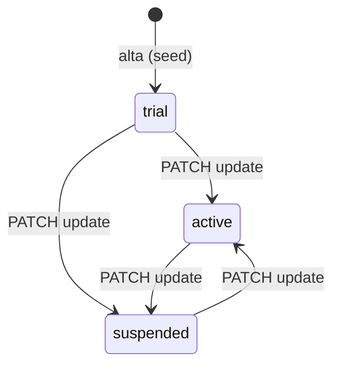

**Tarjeta digital (`card_deliveries`, `card_emails`, `/card`).** El cliente recibe un correo con un enlace a `{FRONTEND_PUBLIC_URL}/tarjeta/<token>`; esa página del frontend pide `GET /card/{token}`, dibuja la tarjeta y arma la imagen y el PDF en el navegador. Reglas (`services/card_service.py`):

- El token son 32 bytes aleatorios (`secrets.token_urlsafe(32)`); en la base solo se guarda su SHA-256. No se deriva del `code` ni del `id`.
- Un enlace activo por cliente: crear uno revoca el anterior. Como el token en claro no se guarda, **cada correo lleva un enlace nuevo** y revoca el que se copió o envió antes.
- El enlace vive lo que vive la tarjeta (DECISIÓN 10): no tiene vencimiento propio, `expires_at` es `valid_until`. Si se renueva la tarjeta, el enlace vuelve a abrir. Token desconocido, revocado, tarjeta vencida o cancelada, o negocio suspendido: siempre el mismo 404 `card_link_not_found`.
- Cancelar la tarjeta llena `revoked_at` de su enlace.
- `GET /card/{token}` solo devuelve negocio (`name`, `logo_url`, `primary_color`, `primary_foreground`; un logo guardado en el bucket sale como la ruta pública `/public/logo/{business_id}.png`, que no caduca), `full_name`, `code`, nivel (`name`, `finish`), `status`, `valid_until` y `wallet.google` (DECISIÓN 11). Nada de correo, teléfono, puntos, cashback ni ids.
- Las rutas `/card` no usan sesión ni cookie. Todas sus respuestas, errores incluidos, llevan `Cache-Control: no-store`, y cada IP tiene `CARD_RATE_LIMIT_PER_MINUTE` peticiones por minuto (30 por defecto; `core/rate_limit.py`, en memoria por proceso; la IP es la reenviada por el proxy gracias a `--proxy-headers`).

Correo (`services/email_service.py`):

- SMTP genérico por variables de entorno (`SMTP_HOST`, `SMTP_PORT`, `SMTP_TLS` = `none` \| `starttls` \| `ssl`, `SMTP_USER`, `SMTP_PASSWORD`, `MAIL_FROM`). En desarrollo, Mailpit de `docker compose` (bandeja en `http://localhost:8025`). Sin `SMTP_HOST`, en desarrollo el correo solo se registra en el log y en una bandeja en memoria; en producción el envío falla.
- El envío corre en un hilo aparte y la petición espera como máximo 1.5 s (`SEND_DEADLINE_SECONDS`). Si el proveedor no termina a tiempo, el resultado es `pending` y el envío sigue en segundo plano.
- Asunto `Tu tarjeta de {negocio}`, remitente con el nombre del negocio y la dirección de `MAIL_FROM`. El cuerpo (texto y HTML) no lleva el código de la tarjeta, ni puntos ni saldo.
- Plantilla del cuerpo (`services/email_templates.py`, diseño aprobado en la wiki → *Identidad de marca* → *Correo de la tarjeta*): tarjeta blanca de 600 px, degradado de marca solo en el encabezado (igual que `/tarjeta`), franja con el acabado metálico del nivel (`bronze`, `silver`, `gold`, `onyx`) y un solo azul primario en el botón. El texto plano repite el mismo mensaje y el nivel.
- La plantilla no usa `<style>` ni CSS externo: todo va en atributos `style` y en tablas, cada degradado lleva `bgcolor` sólido de respaldo y el ancho va en el atributo de la tabla, porque Outlook renderiza con Word. El nivel llega por `_load`, que ahora trae también el `Tier`; `FRONTEND_PUBLIC_URL` arma la URL del wordmark (`{FRONTEND_PUBLIC_URL}/brand/logo-on-dark.png`, estático del frontend).
- El logo del negocio va al correo con la ruta pública `GET /api/v1/public/logo/{business_id}.png` (`logo_service.pass_logo_url`), que no caduca; una llave del bucket se firma con caducidad (`storage_service.public_url`) y el correo la sobrevive, así que esa URL no sirve. Sin logo, se dibuja la ficha con iniciales, que es texto y aguanta el bloqueo de imágenes.
- Límite por cliente: un correo por minuto y cinco por hora (`card_emails`; los intentos fallidos cuentan). El alta con `send_card_email` también cuenta.

Google Wallet (`services/wallet_service.py`):

- `save_url` es `https://pay.google.com/gp/v/save/<jwt>`. El JWT se firma con RS256 usando la llave de la cuenta de servicio (`iss` = su correo, `aud` = `google`, `typ` = `savetowallet`, `origins` = `GOOGLE_WALLET_ORIGINS`).
- El JWT lleva la `LoyaltyClass` del negocio (`<issuer>.business_<business_id>`) y el `LoyaltyObject` del cliente (`<issuer>.customer_<customer_id>`): Google crea los dos la primera vez que se guarda la tarjeta, así que el backend no llama a la API de Wallet. El QR del pase vale exactamente el `code`.
- El pase es una foto fija (DECISIÓN 13): no se actualiza si cambian el nivel o el nombre.
- Necesita `GOOGLE_WALLET_ISSUER_ID`, `GOOGLE_WALLET_SERVICE_ACCOUNT_JSON` y `GOOGLE_WALLET_LOGO_URL` (logo `https` para el pase si el negocio no tiene uno `https`). Si falta alguna, `wallet.google` es `false` y el endpoint responde 503 `wallet_unavailable`.
- `programLogo` es el logo del negocio vía `GET /api/v1/public/logo/{business_id}.png` (`logo_service.pass_logo_url`), un PNG cuadrado de 1024 px con 15 % de margen, que es lo que pide Google (mínimo 660×660, 1:1, recorte circular); si el negocio no tiene logo, se usa `GOOGLE_WALLET_LOGO_URL`. La URL es estable porque Google puede volver a pedir la imagen después de guardar el pase, y una firmada caduca en 1 h.
- El título del pase es fijo: `programLogo` → `issuerName` → `programName` → `hexBackgroundColor` (Google, *Loyalty Template*). `issuerName` se queda en `Member+` y `programName` es el nombre del negocio, así que el pase se lee «Member+ / Café Aurora»; poner el negocio en `issuerName` duplicaría el nombre (decisión del 17 nov 2026).


**Validación de nombres** (`PersonName`, `schemas/validators.py`): se quitan los espacios sobrantes; solo letras (con acentos y ñ), espacios, guion y apóstrofo; mínimo 2 letras y máximo 120 caracteres. Si no se cumple → 422.

**Convención de rutas:** `/<recurso en singular>/<acción>` (`/user/create`, `/user/list`, `/user/{id}/update`). Los módulos nuevos siguen la misma forma, por ejemplo `/customer/create`. Los subrecursos son `/platform/business/list` (la plataforma lista los negocios), `/customer/{customer_id}/card-link` (el enlace a la tarjeta, con la acción `send`), `/customer/{customer_id}/photo` y `/user/photo` (las fotos), `/card/{token}/google-wallet` y `/public/logo/{business_id}.png` (los activos que cargan el pase y el correo); `tests/rules/test_routes.py` los permite con `SUB_RESOURCES`, y un activo público puede llevar su formato en la URL (`ASSET_SUFFIXES`). Sus nombres con guion vienen del contrato del frontend.

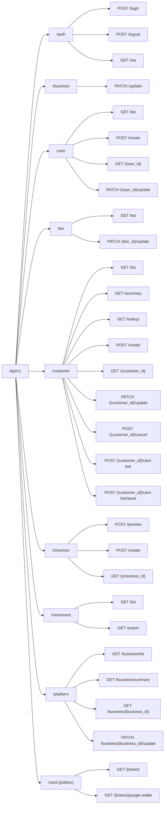

## 5. Inicio y cierre de sesión

### Login

```mermaid
sequenceDiagram
    autonumber
    actor U as Usuario
    participant FE as Frontend
    participant API as auth_api.login
    participant TS as services/turnstile_service
    participant CF as Cloudflare siteverify
    participant SVC as services/auth_service
    participant SEC as core/security
    participant DB as PostgreSQL

    U->>FE: email + contraseña (+ widget Turnstile)
    FE->>API: POST /api/v1/auth/login (form: username, password; header X-Turnstile-Token)
    API->>TS: verify_turnstile(token)
    opt TURNSTILE_ENABLED
        TS->>CF: POST secret + response (sin remoteip, timeout 5 s)
        CF-->>TS: success, hostname, error-codes
    end
    alt token ausente, inválido o Cloudflare sin responder
        API-->>FE: 400 turnstile_failed (no toca login_attempts)
    end
    API->>SVC: login_retry_after(email)
    SVC->>DB: SELECT login_attempts
    alt email bloqueado (5 fallos)
        API-->>FE: 429 Too many failed login attempts + Retry-After
    end
    API->>DB: SELECT user WHERE email = ?
    API->>SEC: verify_password(password, hashed_password)
    alt credenciales incorrectas
        API->>SVC: register_failed_login(email)
        SVC->>DB: failed_count + 1 (bloquea al llegar a 5)
        API-->>FE: 401 Incorrect email or password
    else contraseña correcta
        API->>SVC: clear_failed_logins(email)
        alt usuario inactivo
            API-->>FE: 403 Inactive user
        else su negocio está suspendido
            API-->>FE: 403 Business suspended
        else correcto
            API->>SEC: create_access_token(user_id, role, business_id) + jti único
            SEC-->>API: JWT (HS256, expira en 480 min)
            API-->>FE: 200 {access_token} + Set-Cookie access_token (httpOnly)
        end
    end
```

### Turnstile en el login

Cloudflare Turnstile frena bots en el login (wiki: *Servicios de terceros: Turnstile en el login y respaldos en B2*). Lo hace `services/turnstile_service.py` y lo llama `auth_api.login` **antes** del bloqueo H4.

| `TURNSTILE_ENABLED` | Comportamiento |
|---|---|
| `false` (desarrollo, CI, demo sin internet) | La cabecera se ignora y no se llama a Cloudflare: el login funciona igual que antes |
| `true` (producción) | Un `POST` a `siteverify` con `TURNSTILE_SECRET` y el token, con 5 s de plazo. Pasa solo si Cloudflare responde `success: true` **y** el `hostname` es el de `FRONTEND_PUBLIC_URL`. Todo lo demás (sin token, token inválido, timeout, error de red, respuesta rara) es 400 `turnstile_failed`: *fail-closed* |

- **Orden: Turnstile → bloqueo H4 → credenciales.** Un bot que no pasa Turnstile nunca suma a `login_attempts`, así que no puede bloquear el email de un usuario real.
- **Sin `remoteip`.** El entrypoint confía en cualquier `X-Forwarded-For` (`--forwarded-allow-ips '*'`), así que la IP del cliente no es confiable detrás de Cloudflare y Coolify; `siteverify` funciona sin ella.
- Se registran los `error-codes` de Cloudflare en el log, nunca el secreto.
- Es una cabecera y no un campo del formulario porque el endpoint es `def` síncrono con `OAuth2PasswordRequestForm`: leer otro campo pediría `await request.form()`, que prohíbe `tests/rules/test_sync.py`.

### Límite de intentos (H4)

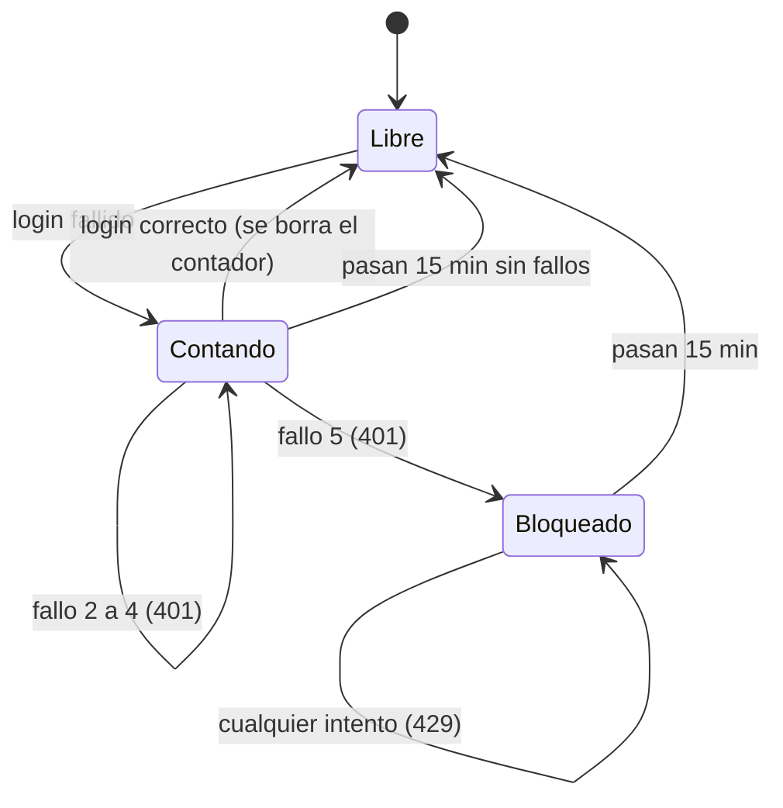

- Es por email, en minúscula, y cuenta igual para emails que no existen, así que no revela cuáles existen.
- Durante el bloqueo, ni la contraseña correcta entra; si no, el bloqueo no frenaría un ataque.
- Configurable con `LOGIN_MAX_ATTEMPTS` (5) y `LOGIN_LOCKOUT_MINUTES` (15).
- Contra: alguien que conozca un email puede bloquearlo 15 minutos a propósito. En producción lo mitiga Turnstile, que va antes del contador. Se acepta para el MVP; la alternativa (contar por IP) no es confiable detrás del proxy de Cloudflare y Coolify.

### Logout (H2)

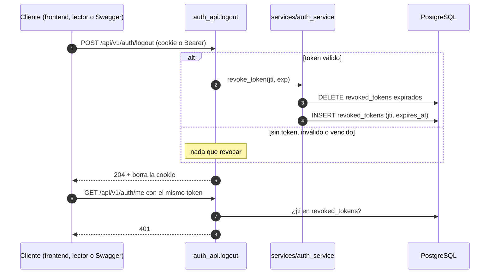

Un JWT no se puede "borrar": sigue siendo válido hasta su `exp`. Por eso cada token lleva un `jti` único y el logout lo guarda en `revoked_tokens`. Solo se cierra **esa** sesión; si el usuario entró desde otro equipo, esa otra sesión sigue abierta. Los tokens emitidos antes de este cambio no tienen `jti` y se rechazan: hay que volver a iniciar sesión una vez.

## 6. Petición autenticada y aislamiento entre negocios

Toda ruta protegida pasa por las dependencias de `api/v1/dependencies.py`. Si el recurso pertenece a otro negocio se responde **404**, igual que si no existiera, para no revelar que existe.

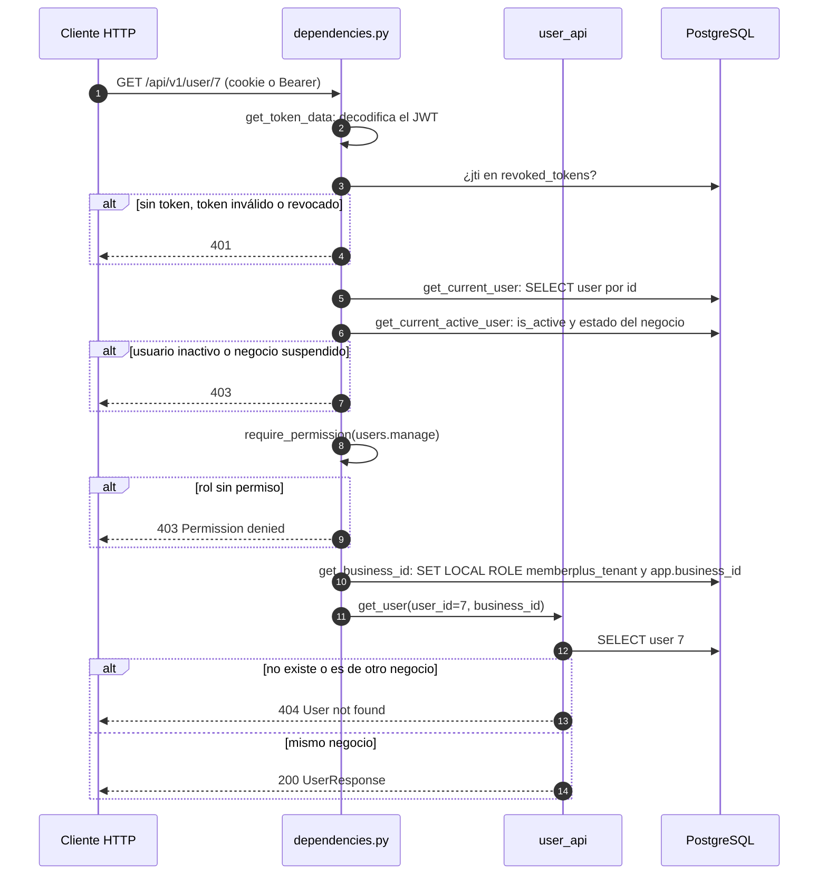

### Cadena de dependencias

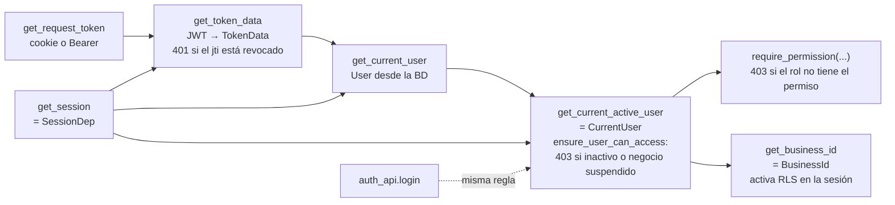

### Row Level Security (defensa en profundidad)

El filtro por `business_id` en cada consulta es la primera barrera. La segunda es PostgreSQL: aunque una consulta olvide el filtro, la base no devuelve ni acepta filas de otro negocio (`db/rls.py`, migración `e4a7b9c1d3f5`, issue #74).

- La migración crea el rol `memberplus_tenant` (sin login y sin `BYPASSRLS`) y una política `tenant_isolation` en cada tabla de negocio: `businesses` compara `id`; `users`, `tiers`, `customers`, `purchases`, `card_deliveries`, `card_emails` y `membership_payments` comparan `business_id`, contra el ajuste `app.business_id`. La política vale para leer (`USING`) y para escribir (`WITH CHECK`): mover o crear una fila en otro negocio también falla.
- `get_business_id` llama a `rls.activate(session, business_id)`: la transacción en curso y cada una que empiece después (evento `after_begin`) corren con `SET LOCAL ROLE memberplus_tenant` y `app.business_id` del token. `SET LOCAL` muere con la transacción, así que una conexión del pool nunca lleva el negocio a otra petición.
- Lo que no pasa por `BusinessId` sigue con el usuario de la conexión, dueño de las tablas (superusuario en Docker y Coolify), que no está sujeto a RLS: login, `/auth/me`, la tarjeta pública, `/public/logo`, el panel de plataforma, el seed y Alembic. Necesitan filas de varios negocios a propósito.
- Con el rol y sin `app.business_id`, la política no deja ver ninguna fila (*fail closed*).
- Las llaves foráneas no se ven afectadas: PostgreSQL las verifica sin RLS.
- SQLite no tiene RLS: ahí `activate()` solo anota el negocio y el aislamiento lo da la aplicación.
- Una tabla nueva con `business_id` va en `rls.TABLES` y su política en una migración nueva; `tests/rules/test_rls.py` falla si falta.

## 7. Arranque de la aplicación

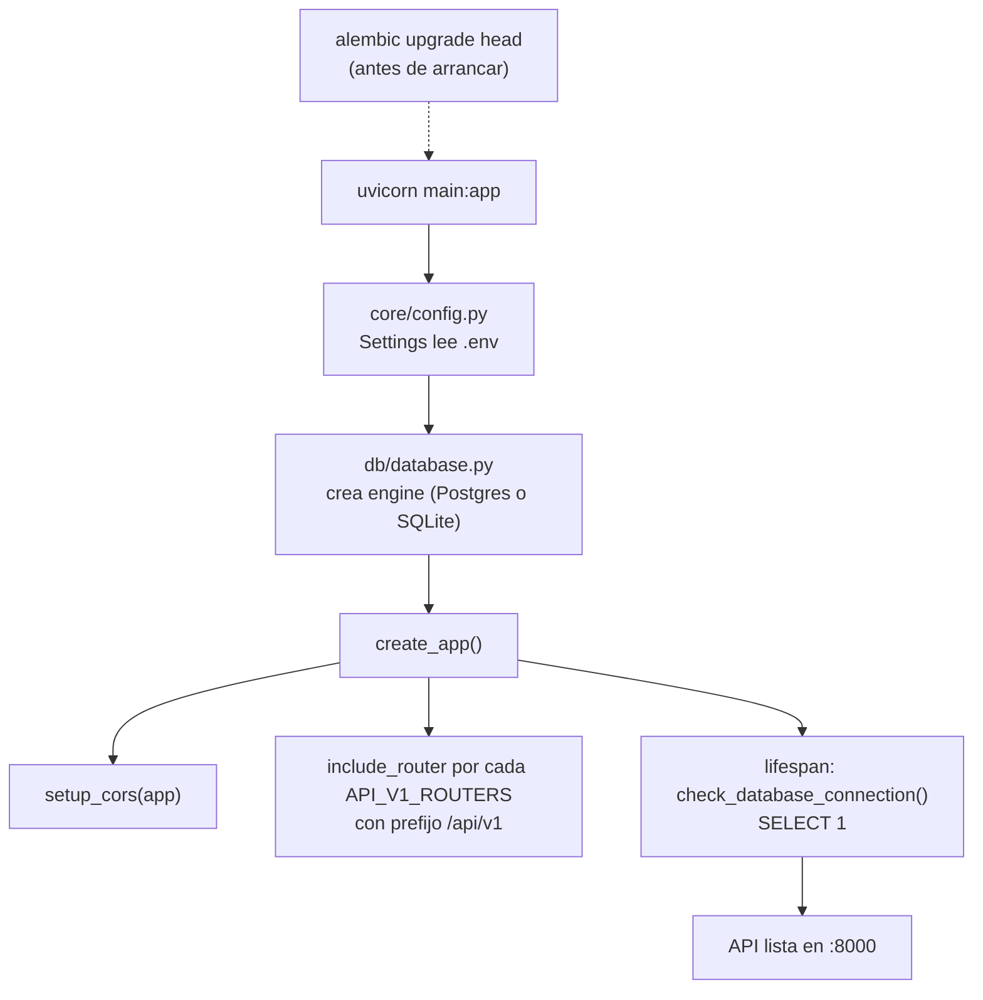

La app **no crea tablas**: el esquema lo maneja Alembic. Detalle en [MIGRATIONS.md](MIGRATIONS.md).

## 8. Cómo agregar un módulo nuevo

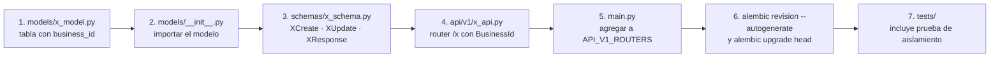

Reglas para todos los módulos:

- Toda tabla de datos de negocio lleva `business_id` y toda consulta filtra por `BusinessId`.
- `business_id` nunca aparece en un schema de entrada (`XCreate`, `XUpdate`).
- Un recurso de otro negocio responde 404.
- Los schemas de salida nunca exponen campos sensibles (`hashed_password`, tokens).
- Los nombres de personas (clientes incluidos) usan `PersonName`.
- Todo `Enum` de un modelo se declara con `sa_type=sa.Enum(X, name="x", values_callable=enum_values)` para guardarse en minúscula.
