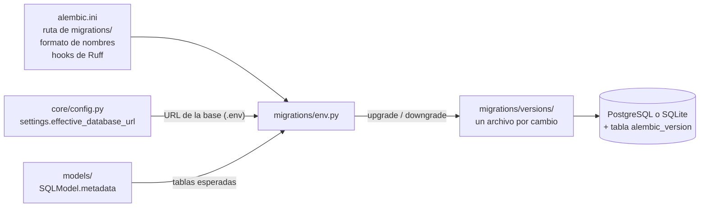
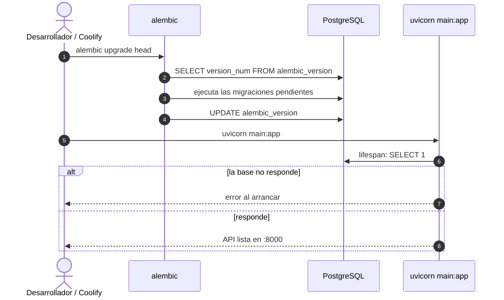
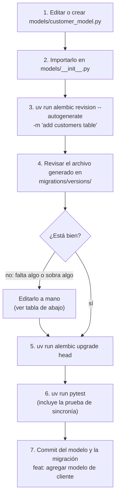
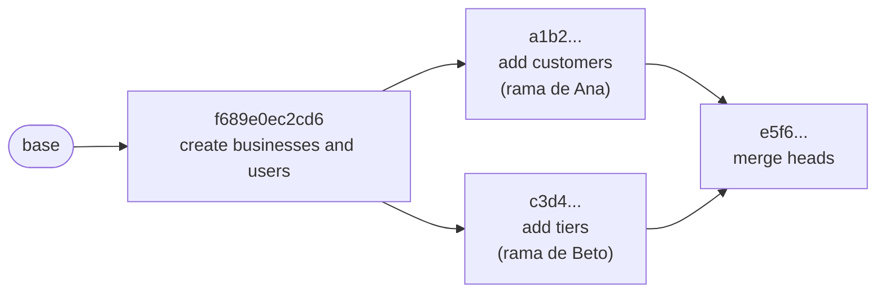
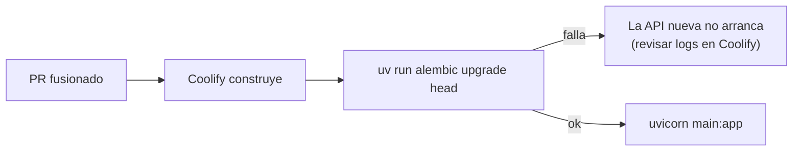
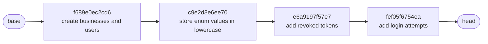

# Migraciones de base de datos — Member+

El esquema de la base de datos se maneja con **[Alembic](https://alembic.sqlalchemy.org/)**. La app **no** crea tablas al arrancar: cada cambio en los modelos se convierte en un archivo de migración que se sube a git y que todos aplican igual en Linux, macOS, Windows y Coolify.

> Arquitectura general: [ARCHITECTURE.md](ARCHITECTURE.md) · Pruebas: [TESTING.md](TESTING.md)

## Índice

1. [Por qué migraciones](#1-por-qué-migraciones)
2. [Comandos](#2-comandos)
3. [Cómo está configurado](#3-cómo-está-configurado)
4. [Flujo para cambiar un modelo](#4-flujo-para-cambiar-un-modelo)
5. [Trabajo en equipo](#5-trabajo-en-equipo)
6. [Despliegue](#6-despliegue)
7. [Migraciones existentes](#7-migraciones-existentes)
8. [Pruebas de las migraciones](#8-pruebas-de-las-migraciones)
9. [Problemas comunes](#9-problemas-comunes)
10. [Reglas](#10-reglas)

---

## 1. Por qué migraciones

Antes, la app ejecutaba `SQLModel.metadata.create_all()` al arrancar. Eso **solo crea tablas que no existen**: si a `User` se le agrega una columna, `create_all` no la agrega a la tabla ya creada, y la base queda desalineada con el código.

| | `create_all` (antes) | Alembic (ahora) |
|---|---|---|
| Crear tablas nuevas | ✅ | ✅ |
| Agregar o cambiar columnas en tablas existentes | ❌ | ✅ |
| Historial de cambios en git | ❌ | ✅ un archivo por cambio |
| Regresar a una versión anterior | ❌ | ✅ `downgrade` |
| Saber en qué versión está cada base | ❌ | ✅ tabla `alembic_version` |
| Mismo resultado en todas las máquinas | ❌ | ✅ |

---

## 2. Comandos

Todos se ejecutan desde la raíz del repo y funcionan igual en Linux, macOS y Windows.

| Comando | Para qué |
|---------|----------|
| `uv run alembic upgrade head` | Aplicar todas las migraciones pendientes |
| `uv run alembic revision --autogenerate -m "add customers table"` | Generar una migración a partir de los cambios en `models/` |
| `uv run alembic check` | Verificar que los modelos y la base coinciden (no genera nada) |
| `uv run alembic current` | Ver en qué versión está la base |
| `uv run alembic history` | Ver todas las migraciones |
| `uv run alembic downgrade -1` | Revertir la última migración |
| `uv run alembic downgrade base` | Revertir todas (deja la base vacía) |
| `uv run alembic upgrade head --sql` | Mostrar el SQL que se ejecutaría, sin ejecutarlo |
| `uv run alembic stamp head` | Marcar la base como actualizada **sin ejecutar nada** (ver [problemas comunes](#9-problemas-comunes)) |

La base a la que apuntan es la de `DATABASE_URL` en el `.env` (o SQLite si está vacío), igual que la app.

---

## 3. Cómo está configurado



| Archivo | Qué hace |
|---------|----------|
| `alembic.ini` | Configuración de Alembic. **No tiene la URL de la base**: la toma del `.env`. Nombra los archivos con fecha (`2026_11_12_0340-<id>_<descripción>.py`) para que se ordenen solos. Después de generar una migración, corre `ruff check --fix` y `ruff format` sobre ella con `python -m ruff`, para que funcione en los tres sistemas. |
| `migrations/env.py` | Conecta Alembic con la app: lee `settings.effective_database_url`, importa `models` para conocer todas las tablas y activa `compare_type` (detecta cambios de tipo). En SQLite usa *batch mode*, porque SQLite no soporta la mayoría de los `ALTER TABLE`. Las pruebas le pasan una conexión ya abierta en `config.attributes["connection"]`. |
| `migrations/script.py.mako` | Plantilla de cada migración nueva. Importa `sqlmodel` porque los modelos usan tipos propios (`AutoString`, `UTCDateTime`). |
| `migrations/versions/` | Las migraciones. **Se suben a git.** |
| `db/database.py` | Ya no crea tablas. `check_database_connection()` hace un `SELECT 1` en el `lifespan` para que la API falle al arrancar, con un error claro, si la base no responde. |

### Arranque de la API



---

## 4. Flujo para cambiar un modelo

Ejemplo: agregar el módulo de clientes.



### Qué revisar en una migración generada

Autogenerate es una ayuda, no un oráculo. Hay cosas que **no detecta** o que hace mal:

| Caso | Qué pasa | Qué hacer |
|------|----------|-----------|
| Renombrar una columna o tabla | Lo ve como *borrar + crear* y **se pierden los datos** | Cambiar a `op.alter_column(..., new_column_name=...)` o `op.rename_table` |
| Agregar un valor a un `Enum` en PostgreSQL | No lo detecta | `op.execute("ALTER TYPE role ADD VALUE 'manager'")` (en minúscula) |
| Renombrar un valor de un `Enum` | No lo detecta | `op.execute("ALTER TYPE role RENAME VALUE 'old' TO 'new'")`; en SQLite, un `UPDATE` (ver `c9e2d3e6ee70`) |
| Borrar una tabla con `Enum` en PostgreSQL | El `downgrade` no borra el tipo `ENUM` | Agregar `sa.Enum(name="...").drop(op.get_bind(), checkfirst=True)` (como en la migración inicial) |
| Columna nueva `NOT NULL` en una tabla con datos | Falla al aplicar | Agregar `server_default`, o crearla nullable, llenarla y luego volverla `NOT NULL` |
| Datos (no estructura) | No los genera | Escribir el `op.execute(...)` o `op.bulk_insert(...)` a mano |
| Políticas RLS, funciones o triggers | No los detecta | Escribirlos con `op.execute(...)` |

Siempre se revisa también el `downgrade()`.

---

## 5. Trabajo en equipo

Cada migración apunta a la anterior con `down_revision`, formando una cadena. Si dos personas crean una migración en ramas distintas, ambas apuntan al mismo padre y aparecen **dos cabezas**:



La prueba `test_there_is_a_single_head` falla en ese caso. Para arreglarlo, quien integra segundo ejecuta:

```bash
uv run alembic merge heads -m "merge customers and tiers"
uv run alembic upgrade head
```

Para evitarlo:

- Antes de generar una migración, actualizar la rama con `main`.
- Una migración por PR, en el mismo PR que el modelo.
- **Nunca editar una migración que ya está en `main`**: se crea una nueva que corrija.

---

## 6. Despliegue



El comando de arranque en Coolify debe ser:

```bash
uv run alembic upgrade head && uv run uvicorn main:app --host 0.0.0.0 --port 8000
```

El `&&` garantiza que la API nunca arranque con un esquema viejo. Antes de una migración que borre o transforme datos, sacar un respaldo con `pg_dump`.

---

## 7. Migraciones existentes

| Revisión | Archivo | Qué hace |
|----------|---------|----------|
| `f689e0ec2cd6` | `2026_11_12_0340-f689e0ec2cd6_create_businesses_and_users.py` | Crea `businesses` y `users`, los tipos `businessstatus` y `role`, el índice de `users.business_id` y el índice único de `users.email`. El `downgrade` borra todo, incluidos los tipos `ENUM`. |
| `c9e2d3e6ee70` | `2026_11_12_0504-c9e2d3e6ee70_store_enum_values_in_lowercase.py` | Escrita a mano (H7). Pasa los `ENUM` a minúscula: en PostgreSQL renombra las etiquetas (`ALTER TYPE ... RENAME VALUE`), y las filas existentes cambian solas; en SQLite actualiza las filas con `lower()`. El `downgrade` hace lo contrario. |
| `e6a9197f57e7` | `2026_11_12_0749-e6a9197f57e7_add_revoked_tokens.py` | Crea `revoked_tokens` (llave `jti`, índice en `expires_at`) para invalidar tokens al cerrar sesión (H2). |
| `fef05f6754ea` | `2026_11_12_0751-fef05f6754ea_add_login_attempts.py` | Crea `login_attempts` (llave `email`, índice en `last_failed_at`) para el límite de intentos de login (H4). |



SQL de la primera migración en PostgreSQL (`uv run alembic upgrade f689e0ec2cd6 --sql`). Crea los `ENUM` en mayúscula; la segunda migración los renombra:

```sql
CREATE TYPE businessstatus AS ENUM ('TRIAL', 'ACTIVE', 'SUSPENDED');

CREATE TABLE businesses (
    id SERIAL NOT NULL,
    name VARCHAR(120) NOT NULL,
    logo_url VARCHAR(500),
    status businessstatus NOT NULL,
    created_at TIMESTAMP WITH TIME ZONE NOT NULL,
    PRIMARY KEY (id)
);

CREATE TYPE role AS ENUM ('PLATFORM', 'ADMIN', 'EMPLOYEE');

CREATE TABLE users (
    id SERIAL NOT NULL,
    business_id INTEGER,
    name VARCHAR(120) NOT NULL,
    email VARCHAR(255) NOT NULL,
    hashed_password VARCHAR NOT NULL,
    role role NOT NULL,
    is_active BOOLEAN NOT NULL,
    created_at TIMESTAMP WITH TIME ZONE NOT NULL,
    PRIMARY KEY (id),
    FOREIGN KEY(business_id) REFERENCES businesses (id)
);

CREATE INDEX ix_users_business_id ON users (business_id);
CREATE UNIQUE INDEX ix_users_email ON users (email);
```

SQL de la segunda migración (`uv run alembic upgrade f689e0ec2cd6:c9e2d3e6ee70 --sql`):

```sql
ALTER TYPE role RENAME VALUE 'PLATFORM' TO 'platform';
ALTER TYPE role RENAME VALUE 'ADMIN' TO 'admin';
ALTER TYPE role RENAME VALUE 'EMPLOYEE' TO 'employee';
ALTER TYPE businessstatus RENAME VALUE 'TRIAL' TO 'trial';
ALTER TYPE businessstatus RENAME VALUE 'ACTIVE' TO 'active';
ALTER TYPE businessstatus RENAME VALUE 'SUSPENDED' TO 'suspended';
```

> **Los `ENUM` se guardan en minúscula** (decisión H7). La base, la API y el SQL escrito a mano usan los mismos valores: `WHERE role = 'admin'`, `status = 'suspended'`. Los modelos lo logran con `sa_type=sa.Enum(..., values_callable=enum_values)` (`models/enum_utils.py`). **Todo `Enum` nuevo debe declararse igual**; si no, SQLAlchemy guarda el nombre en mayúscula.

---

## 8. Pruebas de las migraciones

`tests/db/test_migrations.py` corre en SQLite y en PostgreSQL con el resto de la suite.

| Prueba | Verifica |
|--------|----------|
| `test_there_is_a_single_head` | Hay una sola cabeza: nadie dejó migraciones paralelas sin fusionar |
| `test_upgrade_creates_all_tables` | `upgrade head` en una base vacía crea `businesses`, `users`, `revoked_tokens`, `login_attempts` y `alembic_version` |
| `test_models_and_migrations_are_in_sync` | **Los modelos y las migraciones coinciden.** Falla si alguien cambió un modelo y olvidó generar la migración, y el mensaje le dice qué comando correr |
| `test_downgrade_removes_tables_and_enums` | `downgrade base` borra las tablas y, en PostgreSQL, los tipos `ENUM` |
| `test_upgrade_after_downgrade` | Se puede bajar y volver a subir sin errores |
| `test_database_is_stamped_at_head` | `alembic_version` queda en la última revisión |
| `test_app_works_on_migrated_schema` | La API funciona (login y crear usuario) sobre tablas creadas por Alembic |
| `test_lowercase_enum_migration_converts_existing_rows` | Filas en mayúscula de la primera migración quedan en minúscula con `c9e2d3e6ee70`, y el `downgrade` las regresa |
| `test_app_stores_lowercase_enum_values` | La app guarda `'employee'` y `'trial'` en la base |

Se comprobó que la prueba de sincronía detecta un olvido real: al agregar `phone: str | None` a `User` sin migración, falló con:

```text
Differences: [('add_column', None, 'users', Column('phone', AutoString(), table=<users>))]
```

Las demás pruebas siguen usando `create_all` en su fixture porque es más rápido. La equivalencia entre ambos caminos la garantiza la prueba de sincronía.

---

## 9. Problemas comunes

| Síntoma | Causa | Solución |
|---------|-------|----------|
| `relation "users" already exists` al hacer `upgrade` | La base se creó antes con `create_all` (versiones viejas del proyecto) | Si el esquema es el mismo: `uv run alembic stamp head` y luego `uv run alembic check`. Si no hay datos que cuidar: `docker compose down -v`, `docker compose up -d` y `upgrade head` |
| `type "role" already exists` | Quedó un `ENUM` de un `downgrade` incompleto | `docker exec memberplus-db psql -U memberplus -d memberplus -c 'DROP TYPE role'` |
| `Multiple head revisions are present` | Dos migraciones con el mismo padre | `uv run alembic merge heads -m "merge ..."` ([sección 5](#5-trabajo-en-equipo)) |
| `Target database is not up to date` al usar `check` o `revision` | Hay migraciones sin aplicar | `uv run alembic upgrade head` |
| La migración generada está vacía | El modelo no está importado en `models/__init__.py` | Importarlo y volver a generar |
| La API no arranca: `connection refused` | Postgres apagado | `docker compose up -d` |

### Lo que se hizo con la base de desarrollo existente

La base local de desarrollo ya tenía `businesses` y `users`, creadas por `create_all` y vacías. Se marcó con `stamp` en lugar de borrarla:

```text
$ uv run alembic stamp head
INFO  [alembic.runtime.migration] Running stamp_revision  -> f689e0ec2cd6
$ uv run alembic check
No new upgrade operations detected.
```

Quien tenga una base local creada antes de Alembic debe hacer lo mismo **una sola vez**.

---

## 10. Reglas

- Todo cambio en `models/` lleva su migración **en el mismo commit**.
- Las migraciones se revisan antes de subirlas (sobre todo `downgrade()` y los renombres).
- Nunca editar ni borrar una migración que ya está en `main`.
- Nunca usar `create_all` en la app; solo lo usan las pruebas.
- Mensajes de migración en inglés, en minúscula y descriptivos: `"add customers table"`, `"add phone to users"`.
