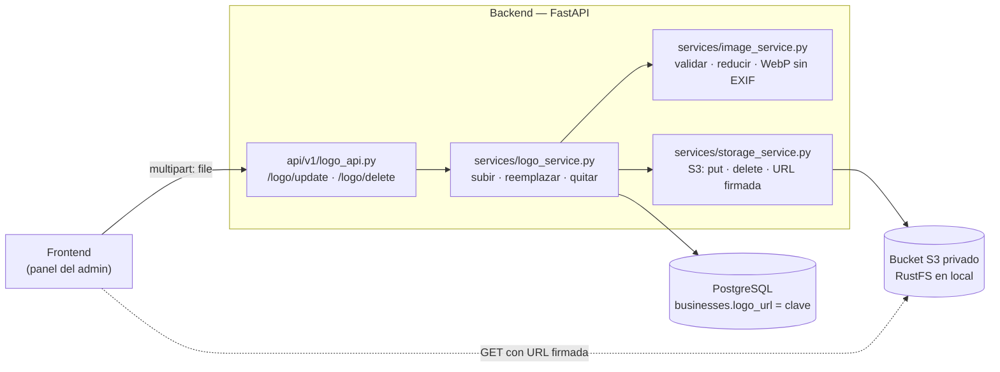
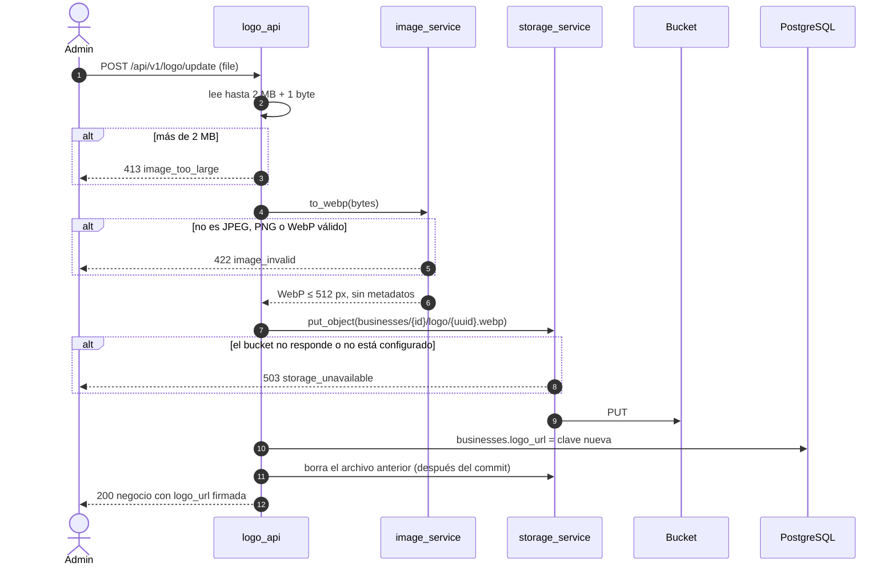

# Almacenamiento de imágenes — Member+

Las imágenes (hoy, el logo de cada negocio) se guardan en un **bucket compatible con S3**, no en la base de datos ni en el disco del contenedor. El backend habla con él por la API estándar de S3 (`boto3`), así que el proveedor se cambia con variables de entorno, sin tocar código.

> Arquitectura: [ARCHITECTURE.md](ARCHITECTURE.md) · Pruebas: [TESTING.md](TESTING.md) · Despliegue: [DEPLOY.md](DEPLOY.md)

## Índice

1. [Qué se guarda y qué no](#1-qué-se-guarda-y-qué-no)
2. [Piezas](#2-piezas)
3. [Correrlo en local](#3-correrlo-en-local)
4. [Cómo funciona una subida](#4-cómo-funciona-una-subida)
5. [Cómo se muestra una imagen](#5-cómo-se-muestra-una-imagen)
6. [Seguridad (DLP)](#6-seguridad-dlp)
7. [Configuración](#7-configuración)
8. [Producción](#8-producción)
9. [Pruebas](#9-pruebas)
10. [Problemas comunes](#10-problemas-comunes)

---

## 1. Qué se guarda y qué no

| Imagen | Estado |
|--------|--------|
| Logo del negocio | ✅ Implementado: `POST /api/v1/logo/update` y `POST /api/v1/logo/delete` |
| Foto de perfil de admins y empleados | Pendiente: necesita una columna nueva en `users` (y su migración) |
| Foto del cliente del negocio | ❌ **No se guarda.** La wiki (*Decisiones por validar*) cerró "no se guardan fotos ni datos biométricos" |

---

## 2. Piezas



| Archivo | Qué hace |
|---------|----------|
| `services/image_service.py` | Recibe los bytes subidos y devuelve un WebP limpio, o rechaza el archivo |
| `services/storage_service.py` | Única puerta al bucket: subir, borrar y firmar URLs. Sin configuración, el almacenamiento queda desactivado |
| `services/logo_service.py` | Une lo anterior con `businesses.logo_url` |
| `api/v1/logo_api.py` | Router delgado: valida el tamaño, delega y traduce errores a códigos estables |
| `docker-compose.yml`, servicio `storage` | RustFS en local, compatible con S3 |

**¿Por qué RustFS y no MinIO?** MinIO dejó de publicar sus imágenes de Docker (Docker Hub, Quay y Bitnami ya no las sirven). RustFS es compatible con S3, usa los mismos puertos (9000 API, 9001 consola) y se configura igual, con usuario y clave por variables. Como el backend solo usa la API de S3, cambiar a MinIO, Garage, Cloudflare R2 o AWS S3 es cambiar las variables de la [sección 7](#7-configuración).

---

## 3. Correrlo en local

```bash
docker compose up -d              # levanta db y storage
uv run uvicorn main:app --reload
```

El `.env` necesita las variables `S3_*` de `.env.example`. El bucket `memberplus` se crea solo en la primera subida.

**Consola web de RustFS:** <http://localhost:9001/rustfs/console/>, con usuario `memberplus` y clave `memberplus-dev-secret` (las de `.env.example`, solo para tu máquina). Ahí se ven los archivos subidos.

Probar una subida con `curl`:

```bash
TOKEN=$(curl -s -X POST localhost:8000/api/v1/auth/login \
  -d 'username=admin@cafe-aurora.mx&password=demo12345' | python3 -c 'import sys,json;print(json.load(sys.stdin)["access_token"])')
curl -X POST localhost:8000/api/v1/logo/update -H "Authorization: Bearer $TOKEN" -F "file=@logo.png"
```

---

## 4. Cómo funciona una subida



- **La validación va primero:** un archivo malo se rechaza aunque el almacenamiento esté caído.
- **El archivo anterior se borra después del `commit`.** Si el `commit` fallara, el negocio seguiría apuntando al logo viejo, que todavía existe.
- **Cada subida usa un nombre nuevo** (`uuid`), así ningún navegador muestra un logo viejo desde su caché.

---

## 5. Cómo se muestra una imagen

En la base se guarda la **clave** (`businesses/1/logo/3956….webp`), nunca una URL. Al responder, `storage_service.public_url()` la convierte:

| Valor en `businesses.logo_url` | Lo que devuelve la API |
|-------------------------------|------------------------|
| `null` | `null` |
| Una URL externa (`https://…`) | La misma URL, sin cambios |
| Una clave, con almacenamiento configurado | URL firmada que caduca en `S3_URL_EXPIRE_SECONDS` (1 h) |
| Una clave, sin almacenamiento configurado | `null` (el frontend muestra su imagen por defecto) |

El logo llega al frontend en `GET /api/v1/auth/me` → `business.logo_url`. Como la URL caduca, el frontend no debe guardarla: la pide de nuevo con `/auth/me`.

---

## 6. Seguridad (DLP)

| Medida | Qué previene |
|--------|--------------|
| **Bucket privado** + URLs firmadas que caducan | Que una imagen quede pública para siempre o que se pueda adivinar su dirección. Sin firma, el bucket responde 403 |
| **Claves separadas por negocio** (`businesses/{business_id}/…`) y `business_id` tomado del token | Que un negocio lea o reemplace archivos de otro |
| **Se borran los metadatos EXIF** | Que una foto tomada con el celular filtre su ubicación GPS, el modelo del equipo o la fecha |
| **Se re-codifica toda subida** a WebP | Que pase un archivo disfrazado de imagen (un PDF o un script con extensión `.png`) |
| **Solo JPEG, PNG y WebP** | GIF, SVG (puede llevar scripts), BMP o TIFF |
| **Máximo 2 MB** y **25 millones de píxeles** | Llenar el disco o tumbar la API con una "bomba de descompresión" |
| **Credenciales en variables de entorno** | Que las llaves del bucket queden en el repo, que es público |

---

## 7. Configuración

| Variable | Local (`.env.example`) | Qué es |
|----------|------------------------|--------|
| `S3_ENDPOINT_URL` | `http://localhost:9000` | Dónde la API habla con el bucket. **Vacía = almacenamiento desactivado** |
| `S3_PUBLIC_ENDPOINT_URL` | vacía | Host que usa el navegador en las URLs firmadas. Vacía = el mismo de arriba. En el perfil `stack` del compose la API usa `http://storage:9000` y el navegador `http://localhost:9000` |
| `S3_ACCESS_KEY` | `memberplus` | Usuario del bucket |
| `S3_SECRET_KEY` | `memberplus-dev-secret` | Clave del bucket. En producción, una propia y larga |
| `S3_BUCKET` | `memberplus` | Nombre del bucket |
| `S3_REGION` | `us-east-1` | Región (RustFS y R2 la ignoran, pero S3 la exige) |
| `S3_URL_EXPIRE_SECONDS` | `3600` | Vigencia de las URLs firmadas (60 s a 7 días) |

---

## 8. Producción

Hoy producción **no tiene bucket**: sin `S3_ENDPOINT_URL`, la API arranca igual, `/logo/update` responde 503 `storage_unavailable` y los logos se reportan como `null`. Para activarlo hay dos caminos, sin cambiar código:

| Opción | Cómo | A favor | En contra |
|--------|------|---------|-----------|
| RustFS en Coolify | Servicio Docker `rustfs/rustfs:1.0.4` con volumen, en la misma red que la API | Todo en el servidor propio, sin terceros | Un servicio más que mantener y **respaldar** |
| Cloudflare R2 | Crear un bucket y una llave de API en Cloudflare | 10 GB gratis, sin costo por descarga; ya usan Cloudflare; **cuenta como servicio de terceros** en la consigna | Depende de internet |

La decisión es del equipo; en cualquiera de los dos, los archivos del bucket entran al plan de respaldo (DRP) junto con `pg_dump`.

---

## 9. Pruebas

Las pruebas no necesitan un servidor de almacenamiento: el fixture `storage` de `tests/conftest.py` usa **moto**, que simula S3 dentro del proceso. El código real de `boto3` se ejecuta igual; solo cambia quién responde. Es la única excepción a la regla de "sin mocks", porque el CI no debe depender de un servicio externo.

Detalle de los casos en [TESTING.md, sección 5.5e](TESTING.md#55e-logo-y-almacenamiento). Además se probó a mano contra RustFS real: una foto JPEG de 2400×1600 con datos GPS (60 KB) quedó como WebP de 512×341 (404 bytes) sin EXIF; la URL firmada respondió 200 y sin firma 403.

---

## 10. Problemas comunes

| Síntoma | Causa | Solución |
|---------|-------|----------|
| `/logo/update` responde 503 `storage_unavailable` | Falta `S3_*` en el `.env` o el contenedor `storage` está apagado | `docker compose up -d` y revisar el `.env` contra `.env.example` |
| La imagen no carga en el navegador | La URL firmada apunta a un host que el navegador no alcanza | Definir `S3_PUBLIC_ENDPOINT_URL` con el host público |
| La imagen dejó de cargar después de un rato | La URL firmada caducó | Volver a pedir `/auth/me` |
| `422 image_invalid` con una imagen que se ve bien | Es GIF, SVG, HEIC u otro formato | Exportarla como PNG, JPEG o WebP |
| `docker compose up` falla con `pull access denied for minio/minio` | MinIO ya no publica sus imágenes | Ya no se usa: el servicio es RustFS |
